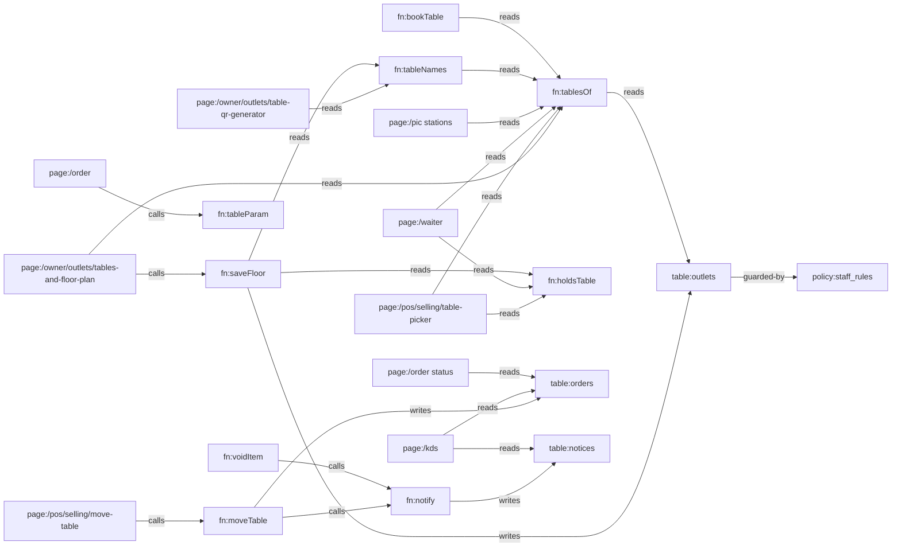

# Knowledge Graph

> Everything is one system. Every page is a node; every line is a real data or design dependency.
> Dikelola oleh skill `alaconnect`. Edit inkremental — jangan generate ulang.
> Graph halaman otomatis (617 halaman, generator `npm run graph`) ada di `KNOWLEDGE_GRAPH.json` dan viewer `/graph`;
> file ini mencatat node kode + data yang dipetakan per task.

Last verified: c5106d2 — 2026-10-18

## Stack

- Next.js 16 (App Router, satu catch-all `app/[[...slug]]`), React 19, TypeScript; test `node --test --experimental-strip-types`.
- Data: adapter lokal (`src/data/store.ts`, localStorage) atau Supabase (`src/data/remoteStore.ts`) — dipilih `src/data/remote.ts` `REMOTE`.
- Sumber kebenaran: halaman/izin/alert dari `spec/` → `npm run spec` → `src/system/*.json` (jangan diedit manual); schema `src/data/schema.ts`; token desain `app/globals.css`; aturan bisnis `src/domain/*`; DB `db/migrations/*`.
- Semua tulisan lewat `commit` (`src/data/actions*.ts`); server menegakkan lewat `bn_write` + trigger `private.docs_guard / docs_rules / staff_rules`.

## Entry points

- Semua route di `src/system/registry.ts` (`npm run paths`); back office pakai template generik kecuali yang ada di `SCREENS` (`src/templates/BackOffice.tsx:17`).
- API: `app/api/**/route.ts`, mesin absen `app/iclock/**`.

## Perintah verifikasi

Tidak ada CI di repo (`.github/workflows` kosong). Urutan murah → mahal:

```bash
npx tsc --noEmit && npm test && npm run -s links && npm run -s check:system && npm run -s check:deploy && npm run -s test:db && npx next build
```

`test:db` butuh Postgres lokal di `localhost:5433` (`/tmp/bnpg`); memasang database lewat `scripts/db-migrate.mjs` (sama dengan produksi) di atas `db/platform.sql`. Verifikasi UI: Playwright (Chromium di `/opt/pw-browsers`) terhadap `npx next start`.

## Nodes

| ID | Tipe | Path | Tanggung jawab (satu kalimat) |
|---|---|---|---|
| comp:FloorGrid | comp | src/ui/Floor.tsx | Menggambar denah satu area (grid sel) untuk editor dan POS |
| comp:Field | comp | src/ui/kit.tsx | Label + kontrol form; label terhubung ke input/select/textarea tunggal |
| fn:saveFloor | fn | src/data/actions/business.ts | Menyimpan denah outlet; menolak hapus/ganti nama meja yang ada tagihan/booking; menyamakan `tables` |
| fn:tablesOf | fn | src/domain/tables.ts | Daftar meja outlet: denah, atau T-01…T-n dari `tables` bila denah kosong |
| fn:tableNames | fn | src/domain/tables.ts | Nama meja outlet dalam urutan denah (dari tablesOf) |
| fn:tableParam | fn | src/domain/tables.ts | Mengubah `?t=` QR menjadi nama meja (07 → T-07, nama lain apa adanya) |
| fn:bookTable | fn | src/data/actions/selforder.ts | Reservasi online tamu: pilih meja bebas terkecil yang muat |
| page:/owner/outlets/tables-and-floor-plan | page | src/screens/floor.tsx | Editor denah per outlet (area, nama, kursi, bentuk, posisi) |
| page:/owner/outlets/outlets | page | src/templates/settingsPages.tsx | Data outlet; kolom Tables jadi tautan ke denah bila denah ada |
| page:/owner/outlets/table-qr-generator | page | src/screens/menu.tsx | Cetak QR per meja dalam urutan denah |
| page:/pos/selling/table-picker | page | src/screens/pos/OrderSheets.tsx | Pilih meja di POS per area, posisi sesuai denah |
| page:/waiter | page | src/screens/waiter.tsx | Daftar meja waiter dengan kursi dan area |
| page:/pic (stations) | page | src/screens/pic.tsx | Section meja PIC per area denah |
| page:/manager | page | src/screens/manager.tsx | Papan meja manager |
| page:/manager create booking | page | src/screens/manager/create.tsx | Form reservasi manager (pilih meja) |
| page:/order (QR menu) | page | src/screens/selforder/shared.tsx | Menu tamu; membaca meja dari QR |
| table:outlets | table | src/data/schema.ts | Outlet; `floor?: FloorTable[]` + `tables` |
| policy:staff_rules | policy | db/migrations/20261016000000_borniz_staff_sessions.sql | Kasir/dapur/waiter tidak boleh menulis `outlets` (termasuk denah) |
| fn:notify | fn | src/data/actions.ts | Satu mesin alert: penerima dari katalog alert, fallback per pemanggil |
| page:/pos/selling/register-order | page | src/screens/pos/Register.tsx | Register POS; hapus/void baris |
| fn:findTable | fn | src/domain/tables.ts | Meja dari QR di denah outlet: nama, lalu nama lama (`was`); null = tidak ada di denah |
| fn:tableNo | fn | src/domain/tables.ts | Label meja untuk tamu: "T-07" → "07", nama lain apa adanya |
| fn:publicUrl | fn | src/system/hosts.ts | URL publik (QR, struk, WA); nama meja di-encode di path `/t/` |
| page:/display | page | src/screens/display.tsx | Customer display |
| page:/account (sign-in, create business) | page | src/screens/auth.tsx | Daftar, masuk, buat bisnis (pilih alamat <slug>.bornis.id) |
| fn:leaveFor | fn | src/system/hosts.ts | Navigasi in-app yang harus pindah host (app. → <slug>.); dipakai go() |
| fn:onBusinessHost | fn | src/system/hosts.ts | Halaman yang sama di host bisnis: daftar/masuk pindah ke <slug>.bornis.id |
| fn:isTenantSlug | fn | src/system/hosts.ts | Nama bisnis yang sah untuk <slug>.bornis.id (bukan host platform, RESERVED) |
| policy:tenants_slug_not_reserved | policy | db/migrations/20261018000000_borniz_tenant_hosts.sql | DB menolak slug yang sama dengan host platform |
| api:/api/bn | api | app/api/bn/[...op]/route.ts | Backend sendiri: rpc/<bn_fn>, read/(members|docs|audit), auth/*, live (SSE) |
| fn:dbCall | fn | src/integrations/server/db.ts | Panggil public.bn_* sebagai pemanggil (anon/authenticated + claim), routing sel per tenant |
| fn:authSession | fn | src/integrations/server/session.ts | Akun, password scrypt, sesi cookie .root, TOTP, link reset sekali pakai |
| fn:liveHub | fn | src/integrations/server/live.ts | LISTEN bn_live per database → stream SSE per bisnis, baris dibaca ulang sebagai user (RLS) |
| policy:bn_guest_write | policy | db/migrations/20261019010000_borniz_guest_fire.sql | Tulisan tamu; notifikasi dapur hanya di batch yang menembakkan item baru |
| test:guest_fire | test | db/tests/guest_fire.sql | Tamu bayar di kasir: pesanan + notifikasi dapur diterima; notifikasi palsu/ulang ditolak |
| test:api | test | db/tests/api.mjs | API ujung ke ujung di role non-superuser: akun, RLS, 2FA, reset, live |
| config:platform | config | db/platform.sql | Platform tanpa Supabase: skema auth (users, sessions, mfa_factors), auth.uid(), role anon/authenticated |
| fn:dbMigrate | fn | scripts/db-migrate.mjs | Pasang/update DB: platform.sql + migration yang belum jalan (ledger public.bn_migrations), hak role app |
| config:deploy | config | deploy/ | Self-host lewat git pull: satu proses Next untuk semua host, nginx meneruskan Host |
| config:proxy | config | proxy.ts | Host → halaman (rewrite/redirect) memakai src/system/hosts.ts |
| fn:holdsTable | fn | src/domain/tables.ts | Satu-satunya aturan "meja terisi": bill terbuka, atau makanan masih di dapur (bayar duluan QR/kiosk) |
| fn:moveTable | fn | src/data/actions.ts | Pindah meja: `movedFrom`, audit `order.table_moved`, alert 'Table moved' ke dapur + waiter bila makanan belum keluar |
| fn:voidItem | fn | src/data/actions.ts | Void item/bill (langsung atau lewat approval `voidIn`); alert 'Item voided' ke dapur + waiter bila sudah di-fire dan belum selesai |
| fn:printTickets | fn | src/devices/hardware.ts | Tiket dapur per station; `banner` untuk slip perubahan (MOVED FROM / VOID) |
| fn:voidSlip | fn | src/screens/pos/shared.tsx | Cetak slip VOID untuk item yang sudah di dapur |
| page:/pos/selling/move-table | page | src/screens/pos/OrderSheets.tsx | Pindah meja: pilih meja asal (semua pesanan hidup di meja itu) → meja kosong |
| page:/kds | page | src/screens/kds.tsx | KDS: banner 'Item voided' / 'Table moved' + "Got it"; tiket menampilkan "T-09 (from T-03)" |
| page:/order status | page | src/screens/selforder/order.tsx | Status pesanan tamu; banner "Table moved" lewat Notices |
| table:orders | table | src/data/schema.ts | Order; `movedFrom?` = meja sebelum dipindah staf |
| table:notices | table | src/data/schema.ts | Alert engine (`notify`); dibaca KDS, waiter, bell |
| test:changes | test | src/data/changes.test.ts | moveTable / voidItem / banner slip |
| test:tables | test | src/domain/tables.test.ts | Aturan denah, sel bebas, parser QR |
| test:floor | test | src/data/floor.test.ts | saveFloor: denah dipakai semua layar, meja bertagihan dilindungi |

## Edges

Arah: `A --tipe--> B` = A bergantung pada B. `?` = belum terverifikasi.

| From | Edge | To | Bukti |
|---|---|---|---|
| page:/owner/outlets/tables-and-floor-plan | calls | fn:saveFloor | src/screens/floor.tsx:45 |
| page:/owner/outlets/tables-and-floor-plan | reads | fn:tablesOf | src/screens/floor.tsx:26 |
| page:/owner/outlets/tables-and-floor-plan | renders | comp:FloorGrid | src/screens/floor.tsx:64 |
| page:/owner/outlets/tables-and-floor-plan | routes-to | page:/owner/outlets/table-qr-generator | src/screens/floor.tsx (Link "Print table QR codes") |
| fn:saveFloor | writes | table:outlets | src/data/actions/business.ts:28 |
| fn:saveFloor | reads | fn:tableNames | src/data/actions/business.ts:26 |
| fn:tableNames | reads | fn:tablesOf | src/domain/tables.ts:15 |
| fn:tablesOf | reads | table:outlets | src/domain/tables.ts (floor / tables) |
| page:/pos/selling/table-picker | reads | fn:tablesOf | src/screens/pos/OrderSheets.tsx:95 |
| page:/pos/selling/table-picker | renders | comp:FloorGrid | src/screens/pos/OrderSheets.tsx:117 |
| page:/waiter | reads | fn:tablesOf | src/screens/waiter.tsx:64 |
| page:/pic (stations) | reads | fn:tablesOf | src/screens/pic.tsx:246 |
| page:/manager | reads | fn:tableNames | src/screens/manager.tsx:208 |
| page:/manager create booking | reads | fn:tableNames | src/screens/manager/create.tsx:73 |
| fn:bookTable | reads | fn:tablesOf | src/data/actions/selforder.ts:45 |
| page:/owner/outlets/table-qr-generator | reads | fn:tableNames | src/screens/menu.tsx:328 |
| page:/order (QR menu) | calls | fn:findTable | src/screens/selforder/shared.tsx:42 (QR lama → meja yang di-rename; tak dikenal → tidak bisa pesan) |
| page:/order (QR menu) | calls | fn:tableParam | src/screens/selforder/shared.tsx:42 |
| page:/owner/outlets/outlets | routes-to | page:/owner/outlets/tables-and-floor-plan | src/templates/settingsPages.tsx:185 |
| table:outlets | guarded-by | policy:staff_rules | db/migrations/20261016000000_borniz_staff_sessions.sql (BN054 list) |
| page:/owner/outlets/tables-and-floor-plan | renders | comp:Field | src/screens/floor.tsx (Name / Seats / Area) |
| page:/pos/selling/table-picker | reads | fn:holdsTable | src/screens/pos/OrderSheets.tsx:95 |
| page:/waiter | reads | fn:holdsTable | src/screens/waiter.tsx:42 |
| page:/manager | reads | fn:holdsTable | src/screens/manager.tsx:209 |
| page:/owner/outlets/tables-and-floor-plan | reads | fn:holdsTable | src/screens/floor.tsx:36 |
| fn:saveFloor | reads | fn:holdsTable | src/data/actions/business.ts:24 |
| page:/pos/selling/move-table | calls | fn:moveTable | src/screens/pos/OrderSheets.tsx:332 |
| page:/pos/selling/move-table | calls | fn:printTickets | src/screens/pos/OrderSheets.tsx:334 |
| fn:moveTable | writes | table:orders | src/data/actions.ts:52 (findOrder → d.orders; movedFrom di :102) |
| fn:moveTable | calls | fn:notify | src/data/actions.ts:103 (notify 'Table moved') |
| fn:notify | writes | table:notices | src/data/actions.ts:39 |
| fn:voidItem | calls | fn:notify | src/data/actions.ts:110 (notify 'Item voided') |
| page:/pos/selling/register-order | calls | fn:voidItem | src/screens/pos/Register.tsx:107 |
| page:/pos/selling/register-order | calls | fn:voidSlip | src/screens/pos/Register.tsx:107 |
| fn:voidSlip | calls | fn:printTickets | src/screens/pos/shared.tsx:186 |
| page:/kds | reads | table:notices | src/screens/kds.tsx:72 |
| page:/kds | reads | table:orders | src/screens/kitchen/model.ts:22 (activeTickets; tiket menampilkan movedFrom) |
| page:/order status | reads | table:orders | src/screens/selforder/shared.tsx:44 (pesanan milik HP ini; movedFrom → ikut pindah) |
| fn:findTable | reads | fn:tablesOf | src/domain/tables.ts:54 |
| page:/display | calls | fn:tableNo | src/screens/display.tsx:185 |
| page:/owner/outlets/table-qr-generator | calls | fn:publicUrl | src/system/hosts.ts:139 (linkTo → publicUrl, dipanggil tableUrl) |
| test:tables | tests | fn:findTable | src/domain/tables.test.ts |
| page:/account (sign-in, create business) | calls | fn:onBusinessHost | src/screens/auth.tsx:515 (enterBusiness) |
| fn:publicUrl | reads | fn:isTenantSlug | src/system/hosts.ts:98 (resolve: label host → tenant) |
| policy:tenants_slug_not_reserved | documents | fn:isTenantSlug | db/migrations/20261018000000_borniz_tenant_hosts.sql (daftar sama dengan RESERVED, isTenantSlug di hosts.ts) |
| api:/api/bn | calls | fn:dbCall | app/api/bn/[...op]/route.ts:7 (import call from db.ts) |
| api:/api/bn | calls | fn:liveHub | app/api/bn/[...op]/route.ts:9 (import subscribe from live.ts) |
| test:api | tests | api:/api/bn | db/tests/api.mjs |
| test:guest_fire | tests | policy:bn_guest_write | db/tests/guest_fire.sql |
| fn:dbMigrate | reads | config:platform | scripts/db-migrate.mjs:25 (db/platform.sql) |
| config:deploy | routes-to | config:proxy | deploy/nginx-proxy.conf:4 (proxy_set_header Host; hosts.ts routes by it) |
| config:deploy | calls | fn:dbMigrate | deploy/update.sh (node --env-file … scripts/db-migrate.mjs); deploy/setup-vps.sh migrasi borniz_dev |
| test:changes | tests | fn:moveTable | src/data/changes.test.ts |
| test:changes | tests | fn:voidItem | src/data/changes.test.ts |
| test:tables | tests | fn:tablesOf | src/domain/tables.test.ts |
| test:floor | tests | fn:saveFloor | src/data/floor.test.ts |

## Diagram



## Temuan

| Tanggal | Node | Temuan | Status |
|---|---|---|---|
| 2026-10-14 | page:/owner/outlets/tables-and-floor-plan | Halaman bernama "floor plan" hanya berisi daftar reservasi | fixed (editor denah) |
| 2026-10-14 | comp:Field | Label tidak terhubung ke input di seluruh aplikasi (a11y, tap label) | fixed |
| 2026-10-14 | src/screens/brand.tsx | Preview KDS menampilkan "T-T-05" (`'T-' + o.table`) | fixed |
| 2026-10-18 | policy:bn_guest_write | BN047: tamu "bayar di kasir" tidak bisa kirim pesanan ke dapur (notifikasi 'New order' dari fire() ditolak, seluruh batch gagal) — juga terjadi di Supabase, baru ketahuan lewat uji ujung ke ujung | fixed (migration guest_fire + tes) |
| 2026-10-18 | src/app/App.tsx | HP tamu menjalankan mesin alert staf (sweepAlerts/escalate/watchKitchen) tiap 60 dtk → tulis alert staf yang selalu ditolak server | fixed (hanya perangkat staf) |
| 2026-10-18 | fn:authSession | 2FA bisa diaktifkan tapi tidak pernah diminta saat login | fixed (kode TOTP wajib saat masuk) |
| 2026-10-18 | config:proxy | Redirect proxy membuang query: QR lama `order.bornis.id/kopibiru/t/07?o=kem` kehilangan outlet | fixed (query ikut) |
| 2026-10-18 | test (npm test) | `--test-force-exit` memotong output: 2 tes terakhir alerts.test.ts kadang tidak dilaporkan (201/203); akar: BroadcastChannel di store.ts menahan proses Node | fixed (unref, flag dihapus; 203 stabil 4×) |
| 2026-10-18 | config:deploy | Di belakang reverse proxy (X-Forwarded-Proto https) dengan `next start -H 127.0.0.1`, semua halaman subdomain 500 ("Failed to proxy https://localhost:3000"); `-H localhost` lolos | fixed (deploy/borniz.service) |
| 2026-10-18 | config:deploy | `.env.example` hanya 5 dari 13 env yang dibaca kode (tanpa Supabase / server secret) | fixed |
| 2026-10-18 | config:deploy | Service jalan sebagai www-data tapi `.env.production` chmod 600 milik root → app tidak bisa baca env, diam-diam jalan mode demo; `git pull` sebagai root di folder milik user lain ditolak git | fixed (user `borniz` memiliki folder + service; update.sh pindah ke pemilik folder) |
| 2026-10-18 | config:deploy | setup-vps.sh: `nginx -t && reload` di bawah `set -e` → config nginx rusak tetap "Done" (ketahuan saat uji di Ubuntu 24.04 container) | fixed (baris terpisah) |
| 2026-10-19 | fn:tOf | Mode database: pelanggan ikut jendela riwayat 35 hari (t = joinedAt) → member lama hilang dari POS, loyalty, template pesan | fixed (UNWINDOWED + migration customers_unwindowed + tes) |
| 2026-10-19 | comp:Link | 113 halaman: prefetch Link ke halaman host lain (terms, developer docs, login) → redirect lintas origin → error CORS | fixed (src/ui/Link.tsx, semua import) |
| 2026-10-19 | src/devices/Connect.tsx | `crypto.randomUUID` tidak ada di http (sebelum sertifikat) → halaman perangkat/kiosk/printer crash | fixed (getRandomValues) |
| 2026-10-19 | src/screens/studio/extras.tsx | Preview referral & custom fields crash di bisnis tanpa pelanggan/produk (`customers[0].name`) | fixed |
| 2026-10-19 | src/templates/Form.tsx | Form PO crash di bisnis tanpa supplier (`suppliers[0].id`) | fixed (Empty state) |
| 2026-10-19 | api:/api/bn | Reset password: link dibangun dari Host header → Host palsu bikin email asli berisi link ke situs penyerang → ambil alih akun tanpa 2FA | fixed (ownsHost + nginx default_server 444 + tes) |
| 2026-10-19 | api:/api/payments/charge | Tamu QR tidak bisa bayar QRIS/VA (tenantId = slug, bukan UUID); orang yang login di bisnis lain ditolak 403 | fixed |
| 2026-10-19 | api:/api/bn | Cookie lama bisa matikan 2FA & ganti password; reset tidak memutus sesi lain; stream live jalan terus setelah logout | fixed (kode 2FA, sesi ≤15 menit, revoke, cek sesi per 25 dtk + tes) |
| 2026-10-19 | config:deploy | nginx `$proxy_add_x_forwarded_for` → IP palsu tembus batas percobaan login | fixed ($remote_addr) |
| 2026-10-19 | api:/api/payments/refund | Refund lewat gateway tanpa approval, bisa dobel bila 2 request bersamaan | fixed (wajib approval refund yang approved, sekali per approval via outbox claim) |
| 2026-10-19 | api:/api/messages/send | Register bersama bisa kirim WA/email ke nomor & pengirim bebas; webhook Studio menerima url+secret dari body | fixed (hanya baris messages yang antre; endpoint & pengirim dari versi Studio yang dipublish) |
| 2026-10-19 | src/app/App.tsx | Outlet aktif dipilih sekali saat data bisnis belum termuat → tetap outlet seed `sen`: bisnis "Start empty" crash di 92 halaman, bisnis lain diam-diam salah outlet | fixed (outlet selalu salah satu outlet bisnis; crawl bisnis kosong 92 → 0) |
| 2026-10-19 | api:/api/payments/charge | Charge dipanggil sebelum baris pembayaran sampai server → 404 "Payment not found" untuk setiap QRIS/VA | fixed (remoteSent: tunggu baris terkirim) |
| 2026-10-19 | api:/api/payments/simulate | Tombol "Simulate payment" di HP tamu → 401 | fixed (tamu boleh untuk pesanan tamu, hanya bila simulator aktif) |
| 2026-10-19 | src/screens/states.tsx | Galeri state crash di bisnis tanpa produk/stok | fixed (pakai data demo) |
| 2026-10-19 | fn:publicUrl | Domain merchant tercatat di 3 tempat (Menu Studio, Platform Studio, admin di browser saja) dan tak satu pun dibaca router; QR/struk pindah ke domain yang belum dilayani server; admin bilang CNAME edge.bornis.id, Studio bilang menu.bornis.id; "sertifikat otomatis" tidak benar | fixed (satu sumber: config deployment + deploy/add-domain.sh; liveDomain; admin lihat permintaan via bn_admin_tenants) |
| 2026-10-19 | src/screens/studios/platform.tsx | Tombol "Continue with Google/Microsoft/SAML" + "Require SSO" tidak melakukan apa-apa | removed (SSO belum dibangun, CLAUDE.md Known gaps) |
| 2026-10-19 | fn:dbMigrate | Semua otomasi (sweep alert, eskalasi, pelunasan QRIS, outbox WA/email/webhook) hanya jalan bila ada perangkat staf terbuka | fixed (worker server: src/integrations/server/worker.ts + borniz-worker.service; uji: QRIS settled → paid tanpa perangkat) |
| 2026-10-19 | config:deploy | update.sh build langsung di .next yang sedang dilayani: build gagal = situs rusak, selama build file setengah jadi | fixed (build ke .next-new lalu tukar; uji: build gagal → situs tetap 200) |
| 2026-10-19 | src/data/actions/admin.ts | Mode database: slug bisnis ditaruh di meta.source (kanal akuisisi) | fixed (meta.slug) |
| 2026-10-19 | src/screens/auth.tsx | Login PIN mengirim SEMUA role ke kasir, dan hanya kasir/PIC/manager/owner yang tampil: dapur & waiter tidak bisa login di KDS / HP waiter (mode database) | fixed (HOME + startFor, staf sesuai halaman tujuan, ?next=) |
| 2026-10-19 | src/session.ts | Customer display di register bersama minta PIN staf; link notifikasi hilang setelah login (selalu ke /owner) | fixed (display tanpa PIN; ?next= dibawa) |
| 2026-10-19 | src/system/hosts.ts | Sesaat setelah login (data bisnis belum termuat, id "") go() pindah ke https://.bornis.id/… lalu app.bornis.id | fixed (tenant \|\| hostTenant + tes yang gagal tanpa fix) |
| 2026-10-19 | src/integrations/Panel.tsx | URL webhook gateway/ojol yang disalin merchant berisi slug, route webhook hanya terima id → setiap pelunasan QRIS & order ojol via webhook ditolak 400 | fixed (id bisnis; uji: slug 400, id lolos ke cek signature) |
| 2026-10-19 | src/system/hosts.ts | Owner Mobile (/system/mobile) dilayani di app. (host tanpa bisnis) | fixed (prefix terpanjang menang: host bisnis) |
| 2026-10-19 | app/manifest.ts | Satu PWA start_url /pos untuk semua: tablet KDS / kiosk / display yang di-install terbuka di kasir | fixed (manifest per aplikasi: /api/app-manifest) |
| 2026-10-19 | src/data/alerts/staff.ts | Katalog menjanjikan WhatsApp ke staf (refund besar, opname, telat, Z report, payslip …) tapi tidak ada yang terkirim | fixed (12 alert dari katalog, saklar owner default mati, uji worker: owner + manager outlet menerima WA tanpa perangkat terbuka) |
| 2026-10-20 | src/data/alerts/rules.ts | Satu outlet tanpa nama (dokumen tak lengkap) membuat index() alert crash → seluruh sweep + otomasi worker bisnis itu berhenti | fixed (name ?? '') |
| 2026-10-20 | fn:liveHub | Live update dibaca ulang per perubahan × per layar di pool 10 koneksi yang sama dengan API: 80 layar + commit 100 dokumen → request biasa (login, bayar) menunggu 2,8 detik | fixed (batch 25 ms, satu baca per akun, pool live sendiri 3 koneksi: 6 ms; tes db/tests/live-load.mjs gagal tanpa fix) |
| 2026-10-20 | policy:staff_rules | Diuji: rantai approval di server (permintaan baru harus waiting BN005, level pemutus BN009, tidak boleh memutus sendiri BN007, PIN approver lewat sesi kasir, satu PIN satu keputusan BN008) | holds — tidak ada bug (db/tests/approvals_db.sql) |
| 2026-10-19 | scripts/tenant-move.sh | Pindah merchant ke DB sendiri belum siap di backend sendiri (routing tanpa p_tenant, migrasi cell, copy auth.users) | fixed 2026-10-20 (call(): p_slug / host / BN050 → cell, akun disalin, plan di dua DB, worker ikut, db:migrate cell, copy akun tanpa duplikat + write_ops; tes move.sh + cells-api.mjs gagal tanpa fix) |
| 2026-10-15 | fn:tableNo | `/^T-?/` membuang "T" dari nama apa pun: "Teras 1" tampil "eras 1" di ±20 layar tamu + customer display | fixed |
| 2026-10-15 | fn:publicUrl | Nama meja tidak di-encode di URL QR: "Bar/1" → meja "Bar", "VIP #2" → "VIP"; "Meja 100%" bikin halaman tamu crash (decode dua kali) | fixed |
| 2026-10-15 | fn:findTable | QR yang sudah tertempel setelah meja di-rename (atau QR asal) membuat pesanan di meja hantu yang tidak ada di denah POS/waiter | fixed (alias `was`; meja tak dikenal = tidak bisa pesan) |
| 2026-10-15 | page:/owner/outlets/tables-and-floor-plan | Kunci edit = nama: mengetik nama yang sama dengan meja lain mengedit DUA meja sekaligus | fixed (kunci internal `k`) |
| 2026-10-15 | page:/owner/outlets/tables-and-floor-plan | Ganti outlet dengan perubahan belum disimpan: denah outlet A tampil (dan tersimpan) sebagai outlet B | fixed (editor di-key per outlet) |
| 2026-10-15 | policy:staff_rules | Server (`bn_guest_write`) tidak memvalidasi nama meja terhadap denah; validasi baru di client | open |
| 2026-10-14 | fn:holdsTable | 8 definisi "pesanan aktif" berbeda; pesanan QR lunas (QRIS) yang masih dimasak tampil "meja kosong" di POS/waiter/manager/denah → kasir duduk-kan tamu baru di meja yang sama, owner bisa hapus mejanya | fixed (satu aturan) |
| 2026-10-14 | page:/pos/selling/move-table | Move hanya bisa pindah bill terbuka (`cur`); pesanan lunas yang masih dimasak tidak bisa dipindah | fixed (pindah per meja) |
| 2026-10-14 | fn:moveTable | Pindah meja = `patchOrder` diam: tiket cetak tetap meja lama, dapur/waiter tidak diberi tahu, HP tamu kehilangan pesanannya | fixed |
| 2026-10-14 | fn:voidItem | Void item yang sudah di dapur hilang diam-diam dari KDS; tiket kertas tetap → dimasak juga | fixed (alert + slip VOID) |
| 2026-10-14 | page:/owner/outlets/table-qr-generator | Default "To table" 12 tetap → meja 13+ tidak pernah dapat QR | fixed (0 = semua) |

## Keputusan

| Tanggal | Keputusan | Alasan | Node terdampak |
|---|---|---|---|
| 2026-10-19 | Domain merchant diaktifkan operator (deploy/add-domain.sh), bukan routing dinamis dari DB | Halaman statis (618) + env yang di-bake saat build; satu VPS, merchant enterprise jarang: script lebih sederhana dan benar daripada cookie/edge config | fn:publicUrl, config:deploy |
| 2026-10-19 | Worker otomasi = proses Node terpisah (systemd), bukan di dalam Next | Next mengompilasi instrumentation sebagai Server Component yang menolak modul ber-hook; proses terpisah memakai kode yang sama tanpa build | fn:dbMigrate, config:deploy |
| 2026-10-18 | Satu VPS = dua salinan: live `/srv/borniz` + DB `borniz`, dev `/srv/borniz-dev` + DB `borniz_dev` (PostgreSQL yang sama), user `borniz`; dev lewat SSH tunnel :3001 | Owner mau develop langsung di VPS; develop di folder/DB live = setiap edit langsung kena pelanggan dan migrasi setengah jadi merusak data asli | config:deploy, fn:dbMigrate |
| 2026-10-14 | Kunci meja = namanya | `orders.table` / `reservations.table` / tiket sudah menyimpan nama; rename meja bertagihan ditolak | fn:saveFloor, semua konsumen |
| 2026-10-14 | "Pindah meja" memindah semua pesanan hidup di meja itu | Satu meja bisa punya pesanan QR lunas + ronde POS baru; tamu pindah bersama semuanya | page:/pos/selling/move-table |
| 2026-10-14 | HP tamu ikut pindah hanya bila staf yang memindah (`movedFrom`); tamu yang pindah sendiri dapat tombol "minta staf pindahkan" | QR lama di URL tidak boleh menarik pesanan kembali; scan meja lain = niat tamu | page:/order status |
| 2026-10-18 | Jalan 2: PostgreSQL sendiri tanpa software Supabase; logika SQL (migrations) dipakai utuh di atas platform.sql | Owner pakai VPS sendiri; semua aturan DB sudah teruji di Postgres biasa | config:platform, fn:dbMigrate |
| 2026-10-18 | Jalan 2 selesai: tanpa software Supabase; API sendiri (app/api/bn), login sendiri (cookie .root), realtime NOTIFY→SSE, folder supabase/ → db/ | Owner memilih PostgreSQL sendiri di VPS | api:/api/bn, fn:authSession, fn:liveHub, fn:dbCall |
| 2026-10-18 | SEMUA milik bisnis (owner, manager, studios, POS, PIC, online, waiter, KDS, display, QR, kiosk) di `<slug>.bornis.id`; platform = bornis.id, app. (daftar/masuk), admin.; pos./kds./display. → app., order.<slug> → <slug>.; daftar baru memilih alamat dan langsung pindah ke subdomain | Keputusan owner (2×), mengganti pembagian host spec | fn:publicUrl, fn:leaveFor, fn:onBusinessHost, fn:isTenantSlug, config:deploy |
| 2026-10-18 | Bisnis di `<slug>.bornis.id` (bukan `order.bornis.id/<slug>`); link lama di-redirect; slug platform ditolak di app + DB | Keputusan owner; spec Sitemap masih `order.` | fn:publicUrl, fn:isTenantSlug, config:deploy |
| 2026-10-18 | Satu folder repo + satu proses untuk semua subdomain; tidak ada folder/app per subdomain | Kode dipakai lintas host (insight/, ops/, guest/); salinan per subdomain = data & logika bercabang (keputusan owner "one system") | config:deploy |
| 2026-10-15 | Rename meja menyimpan nama lama di `was` | QR yang sudah tertempel tetap jalan sampai dicetak ulang | fn:findTable, page:/owner/outlets/tables-and-floor-plan |
| 2026-10-14 | Denah kosong = T-01…T-n dari `tables` | Data lama tetap jalan tanpa migrasi | fn:tablesOf |
