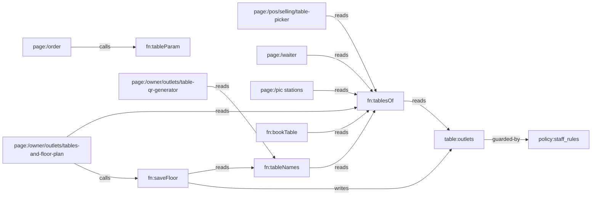

# Knowledge Graph

> Everything is one system. Every page is a node; every line is a real data or design dependency.
> Dikelola oleh skill `alaconnect`. Edit inkremental — jangan generate ulang.
> Graph halaman otomatis (617 halaman, generator `npm run graph`) ada di `KNOWLEDGE_GRAPH.json` dan viewer `/graph`;
> file ini mencatat node kode + data yang dipetakan per task.

Last verified: 3ac4f55 — 2026-10-14

## Stack

- Next.js 16 (App Router, satu catch-all `app/[[...slug]]`), React 19, TypeScript; test `node --test --experimental-strip-types`.
- Data: adapter lokal (`src/data/store.ts`, localStorage) atau Supabase (`src/data/supabaseStore.ts`) — dipilih `src/data/remote.ts` `REMOTE`.
- Sumber kebenaran: halaman/izin/alert dari `spec/` → `npm run spec` → `src/system/*.json` (jangan diedit manual); schema `src/data/schema.ts`; token desain `app/globals.css`; aturan bisnis `src/domain/*`; DB `supabase/migrations/*`.
- Semua tulisan lewat `commit` (`src/data/actions*.ts`); server menegakkan lewat `bn_write` + trigger `private.docs_guard / docs_rules / staff_rules`.

## Entry points

- Semua route di `src/system/registry.ts` (`npm run paths`); back office pakai template generik kecuali yang ada di `SCREENS` (`src/templates/BackOffice.tsx:17`).
- API: `app/api/**/route.ts`, mesin absen `app/iclock/**`.

## Perintah verifikasi

Tidak ada CI di repo (`.github/workflows` kosong). Urutan murah → mahal:

```bash
npx tsc --noEmit && npm test && npm run -s links && npm run -s check:system && npm run -s test:db && npx next build
```

`test:db` butuh Postgres lokal di `localhost:5433` (`/tmp/bnpg`). Verifikasi UI: Playwright (Chromium di `/opt/pw-browsers`) terhadap `npx next start`.

## Nodes

| ID | Tipe | Path | Tanggung jawab (satu kalimat) |
|---|---|---|---|
| comp:FloorGrid | comp | src/ui/Floor.tsx | Menggambar denah satu area (grid sel) untuk editor dan POS |
| comp:Field | comp | src/ui/kit.tsx | Label + kontrol form; label terhubung ke input/select/textarea tunggal |
| fn:saveFloor | fn | src/data/actions/business.ts | Menyimpan denah outlet; menolak hapus/ganti nama meja yang ada tagihan/booking; menyamakan `tables` |
| fn:tablesOf | fn | src/domain/tables.ts | Daftar meja outlet: denah, atau T-01…T-n dari `tables` bila denah kosong |
| fn:tableNames | fn | src/domain/tables.ts | Nama meja outlet dalam urutan denah (dari tablesOf) |
| fn:tableParam | fn | src/domain/tables.ts | Mengubah `?t=` QR menjadi nama meja (07 → T-07, nama lain apa adanya) |
| fn:bookTable | fn | src/data/actions/selforder.ts | Reservasi online tamu: pilih meja bebas terkecil yang muat |
| page:/owner/outlets/tables-and-floor-plan | page | src/screens/floor.tsx | Editor denah per outlet (area, nama, kursi, bentuk, posisi) |
| page:/owner/outlets/outlets | page | src/templates/settingsPages.tsx | Data outlet; kolom Tables jadi tautan ke denah bila denah ada |
| page:/owner/outlets/table-qr-generator | page | src/screens/menu.tsx | Cetak QR per meja dalam urutan denah |
| page:/pos/selling/table-picker | page | src/screens/pos/OrderSheets.tsx | Pilih meja di POS per area, posisi sesuai denah |
| page:/waiter | page | src/screens/waiter.tsx | Daftar meja waiter dengan kursi dan area |
| page:/pic (stations) | page | src/screens/pic.tsx | Section meja PIC per area denah |
| page:/manager | page | src/screens/manager.tsx | Papan meja manager |
| page:/manager create booking | page | src/screens/manager/create.tsx | Form reservasi manager (pilih meja) |
| page:/order (QR menu) | page | src/screens/selforder/shared.tsx | Menu tamu; membaca meja dari QR |
| table:outlets | table | src/data/schema.ts | Outlet; `floor?: FloorTable[]` + `tables` |
| policy:staff_rules | policy | supabase/migrations/20261016000000_borniz_staff_sessions.sql | Kasir/dapur/waiter tidak boleh menulis `outlets` (termasuk denah) |
| test:tables | test | src/domain/tables.test.ts | Aturan denah, sel bebas, parser QR |
| test:floor | test | src/data/floor.test.ts | saveFloor: denah dipakai semua layar, meja bertagihan dilindungi |

## Edges

Arah: `A --tipe--> B` = A bergantung pada B. `?` = belum terverifikasi.

| From | Edge | To | Bukti |
|---|---|---|---|
| page:/owner/outlets/tables-and-floor-plan | calls | fn:saveFloor | src/screens/floor.tsx:39 |
| page:/owner/outlets/tables-and-floor-plan | reads | fn:tablesOf | src/screens/floor.tsx:20 |
| page:/owner/outlets/tables-and-floor-plan | renders | comp:FloorGrid | src/screens/floor.tsx:58 |
| page:/owner/outlets/tables-and-floor-plan | routes-to | page:/owner/outlets/table-qr-generator | src/screens/floor.tsx (Link "Print table QR codes") |
| fn:saveFloor | writes | table:outlets | src/data/actions/business.ts:29 |
| fn:saveFloor | reads | fn:tableNames | src/data/actions/business.ts:27 |
| fn:tableNames | reads | fn:tablesOf | src/domain/tables.ts:15 |
| fn:tablesOf | reads | table:outlets | src/domain/tables.ts (floor / tables) |
| page:/pos/selling/table-picker | reads | fn:tablesOf | src/screens/pos/OrderSheets.tsx:93 |
| page:/pos/selling/table-picker | renders | comp:FloorGrid | src/screens/pos/OrderSheets.tsx:115 |
| page:/waiter | reads | fn:tablesOf | src/screens/waiter.tsx:62 |
| page:/pic (stations) | reads | fn:tablesOf | src/screens/pic.tsx:246 |
| page:/manager | reads | fn:tableNames | src/screens/manager.tsx:208 |
| page:/manager create booking | reads | fn:tableNames | src/screens/manager/create.tsx:73 |
| fn:bookTable | reads | fn:tablesOf | src/data/actions/selforder.ts:45 |
| page:/owner/outlets/table-qr-generator | reads | fn:tableNames | src/screens/menu.tsx:328 |
| page:/order (QR menu) | calls | fn:tableParam | src/screens/selforder/shared.tsx:37 |
| page:/owner/outlets/outlets | routes-to | page:/owner/outlets/tables-and-floor-plan | src/templates/settingsPages.tsx:181 |
| table:outlets | guarded-by | policy:staff_rules | supabase/migrations/20261016000000_borniz_staff_sessions.sql (BN054 list) |
| page:/owner/outlets/tables-and-floor-plan | renders | comp:Field | src/screens/floor.tsx (Name / Seats / Area) |
| test:tables | tests | fn:tablesOf | src/domain/tables.test.ts |
| test:floor | tests | fn:saveFloor | src/data/floor.test.ts |

## Diagram



## Temuan

| Tanggal | Node | Temuan | Status |
|---|---|---|---|
| 2026-10-14 | page:/owner/outlets/tables-and-floor-plan | Halaman bernama "floor plan" hanya berisi daftar reservasi | fixed (editor denah) |
| 2026-10-14 | comp:Field | Label tidak terhubung ke input di seluruh aplikasi (a11y, tap label) | fixed |
| 2026-10-14 | src/screens/brand.tsx | Preview KDS menampilkan "T-T-05" (`'T-' + o.table`) | fixed |
| 2026-10-14 | page:/owner/outlets/table-qr-generator | Default "To table" 12 tetap → meja 13+ tidak pernah dapat QR | fixed (0 = semua) |

## Keputusan

| Tanggal | Keputusan | Alasan | Node terdampak |
|---|---|---|---|
| 2026-10-14 | Kunci meja = namanya | `orders.table` / `reservations.table` / tiket sudah menyimpan nama; rename meja bertagihan ditolak | fn:saveFloor, semua konsumen |
| 2026-10-14 | Denah kosong = T-01…T-n dari `tables` | Data lama tetap jalan tanpa migrasi | fn:tablesOf |
