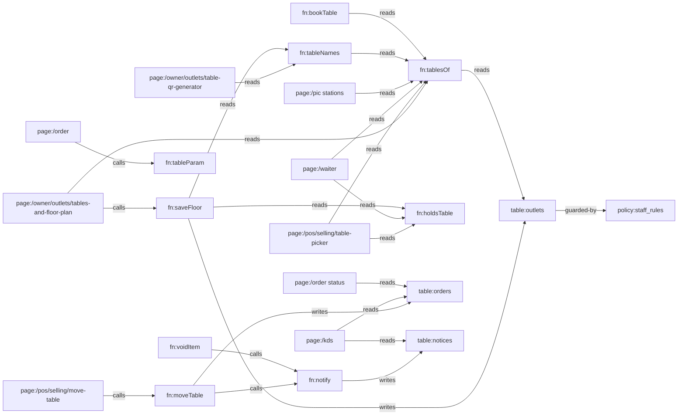

# Knowledge Graph

> Everything is one system. Every page is a node; every line is a real data or design dependency.
> Dikelola oleh skill `alaconnect`. Edit inkremental — jangan generate ulang.
> Graph halaman otomatis (617 halaman, generator `npm run graph`) ada di `KNOWLEDGE_GRAPH.json` dan viewer `/graph`;
> file ini mencatat node kode + data yang dipetakan per task.

Last verified: 82a35e2 — 2026-10-18

## Stack

- Next.js 16 (App Router, satu catch-all `app/[[...slug]]`), React 19, TypeScript; test `node --test --experimental-strip-types`.
- Data: adapter lokal (`src/data/store.ts`, localStorage) atau Supabase (`src/data/supabaseStore.ts`) — dipilih `src/data/remote.ts` `REMOTE`.
- Sumber kebenaran: halaman/izin/alert dari `spec/` → `npm run spec` → `src/system/*.json` (jangan diedit manual); schema `src/data/schema.ts`; token desain `app/globals.css`; aturan bisnis `src/domain/*`; DB `supabase/migrations/*`.
- Semua tulisan lewat `commit` (`src/data/actions*.ts`); server menegakkan lewat `bn_write` + trigger `private.docs_guard / docs_rules / staff_rules`.

## Entry points

- Semua route di `src/system/registry.ts` (`npm run paths`); back office pakai template generik kecuali yang ada di `SCREENS` (`src/templates/BackOffice.tsx:17`).
- API: `app/api/**/route.ts`, mesin absen `app/iclock/**`.

## Perintah verifikasi

Tidak ada CI di repo (`.github/workflows` kosong). Urutan murah → mahal:

```bash
npx tsc --noEmit && npm test && npm run -s links && npm run -s check:system && npm run -s test:db && npx next build
```

`test:db` butuh Postgres lokal di `localhost:5433` (`/tmp/bnpg`). Verifikasi UI: Playwright (Chromium di `/opt/pw-browsers`) terhadap `npx next start`.

## Nodes

| ID | Tipe | Path | Tanggung jawab (satu kalimat) |
|---|---|---|---|
| comp:FloorGrid | comp | src/ui/Floor.tsx | Menggambar denah satu area (grid sel) untuk editor dan POS |
| comp:Field | comp | src/ui/kit.tsx | Label + kontrol form; label terhubung ke input/select/textarea tunggal |
| fn:saveFloor | fn | src/data/actions/business.ts | Menyimpan denah outlet; menolak hapus/ganti nama meja yang ada tagihan/booking; menyamakan `tables` |
| fn:tablesOf | fn | src/domain/tables.ts | Daftar meja outlet: denah, atau T-01…T-n dari `tables` bila denah kosong |
| fn:tableNames | fn | src/domain/tables.ts | Nama meja outlet dalam urutan denah (dari tablesOf) |
| fn:tableParam | fn | src/domain/tables.ts | Mengubah `?t=` QR menjadi nama meja (07 → T-07, nama lain apa adanya) |
| fn:bookTable | fn | src/data/actions/selforder.ts | Reservasi online tamu: pilih meja bebas terkecil yang muat |
| page:/owner/outlets/tables-and-floor-plan | page | src/screens/floor.tsx | Editor denah per outlet (area, nama, kursi, bentuk, posisi) |
| page:/owner/outlets/outlets | page | src/templates/settingsPages.tsx | Data outlet; kolom Tables jadi tautan ke denah bila denah ada |
| page:/owner/outlets/table-qr-generator | page | src/screens/menu.tsx | Cetak QR per meja dalam urutan denah |
| page:/pos/selling/table-picker | page | src/screens/pos/OrderSheets.tsx | Pilih meja di POS per area, posisi sesuai denah |
| page:/waiter | page | src/screens/waiter.tsx | Daftar meja waiter dengan kursi dan area |
| page:/pic (stations) | page | src/screens/pic.tsx | Section meja PIC per area denah |
| page:/manager | page | src/screens/manager.tsx | Papan meja manager |
| page:/manager create booking | page | src/screens/manager/create.tsx | Form reservasi manager (pilih meja) |
| page:/order (QR menu) | page | src/screens/selforder/shared.tsx | Menu tamu; membaca meja dari QR |
| table:outlets | table | src/data/schema.ts | Outlet; `floor?: FloorTable[]` + `tables` |
| policy:staff_rules | policy | supabase/migrations/20261016000000_borniz_staff_sessions.sql | Kasir/dapur/waiter tidak boleh menulis `outlets` (termasuk denah) |
| fn:notify | fn | src/data/actions.ts | Satu mesin alert: penerima dari katalog alert, fallback per pemanggil |
| page:/pos/selling/register-order | page | src/screens/pos/Register.tsx | Register POS; hapus/void baris |
| fn:findTable | fn | src/domain/tables.ts | Meja dari QR di denah outlet: nama, lalu nama lama (`was`); null = tidak ada di denah |
| fn:tableNo | fn | src/domain/tables.ts | Label meja untuk tamu: "T-07" → "07", nama lain apa adanya |
| fn:publicUrl | fn | src/system/hosts.ts | URL publik (QR, struk, WA); nama meja di-encode di path `/t/` |
| page:/display | page | src/screens/display.tsx | Customer display |
| config:deploy | config | deploy/ | Self-host lewat git pull: satu proses Next untuk semua host, nginx meneruskan Host |
| config:proxy | config | proxy.ts | Host → halaman (rewrite/redirect) memakai src/system/hosts.ts |
| fn:holdsTable | fn | src/domain/tables.ts | Satu-satunya aturan "meja terisi": bill terbuka, atau makanan masih di dapur (bayar duluan QR/kiosk) |
| fn:moveTable | fn | src/data/actions.ts | Pindah meja: `movedFrom`, audit `order.table_moved`, alert 'Table moved' ke dapur + waiter bila makanan belum keluar |
| fn:voidItem | fn | src/data/actions.ts | Void item/bill (langsung atau lewat approval `voidIn`); alert 'Item voided' ke dapur + waiter bila sudah di-fire dan belum selesai |
| fn:printTickets | fn | src/devices/hardware.ts | Tiket dapur per station; `banner` untuk slip perubahan (MOVED FROM / VOID) |
| fn:voidSlip | fn | src/screens/pos/shared.tsx | Cetak slip VOID untuk item yang sudah di dapur |
| page:/pos/selling/move-table | page | src/screens/pos/OrderSheets.tsx | Pindah meja: pilih meja asal (semua pesanan hidup di meja itu) → meja kosong |
| page:/kds | page | src/screens/kds.tsx | KDS: banner 'Item voided' / 'Table moved' + "Got it"; tiket menampilkan "T-09 (from T-03)" |
| page:/order status | page | src/screens/selforder/order.tsx | Status pesanan tamu; banner "Table moved" lewat Notices |
| table:orders | table | src/data/schema.ts | Order; `movedFrom?` = meja sebelum dipindah staf |
| table:notices | table | src/data/schema.ts | Alert engine (`notify`); dibaca KDS, waiter, bell |
| test:changes | test | src/data/changes.test.ts | moveTable / voidItem / banner slip |
| test:tables | test | src/domain/tables.test.ts | Aturan denah, sel bebas, parser QR |
| test:floor | test | src/data/floor.test.ts | saveFloor: denah dipakai semua layar, meja bertagihan dilindungi |

## Edges

Arah: `A --tipe--> B` = A bergantung pada B. `?` = belum terverifikasi.

| From | Edge | To | Bukti |
|---|---|---|---|
| page:/owner/outlets/tables-and-floor-plan | calls | fn:saveFloor | src/screens/floor.tsx:45 |
| page:/owner/outlets/tables-and-floor-plan | reads | fn:tablesOf | src/screens/floor.tsx:26 |
| page:/owner/outlets/tables-and-floor-plan | renders | comp:FloorGrid | src/screens/floor.tsx:64 |
| page:/owner/outlets/tables-and-floor-plan | routes-to | page:/owner/outlets/table-qr-generator | src/screens/floor.tsx (Link "Print table QR codes") |
| fn:saveFloor | writes | table:outlets | src/data/actions/business.ts:28 |
| fn:saveFloor | reads | fn:tableNames | src/data/actions/business.ts:26 |
| fn:tableNames | reads | fn:tablesOf | src/domain/tables.ts:15 |
| fn:tablesOf | reads | table:outlets | src/domain/tables.ts (floor / tables) |
| page:/pos/selling/table-picker | reads | fn:tablesOf | src/screens/pos/OrderSheets.tsx:95 |
| page:/pos/selling/table-picker | renders | comp:FloorGrid | src/screens/pos/OrderSheets.tsx:117 |
| page:/waiter | reads | fn:tablesOf | src/screens/waiter.tsx:64 |
| page:/pic (stations) | reads | fn:tablesOf | src/screens/pic.tsx:246 |
| page:/manager | reads | fn:tableNames | src/screens/manager.tsx:208 |
| page:/manager create booking | reads | fn:tableNames | src/screens/manager/create.tsx:73 |
| fn:bookTable | reads | fn:tablesOf | src/data/actions/selforder.ts:45 |
| page:/owner/outlets/table-qr-generator | reads | fn:tableNames | src/screens/menu.tsx:328 |
| page:/order (QR menu) | calls | fn:findTable | src/screens/selforder/shared.tsx:42 (QR lama → meja yang di-rename; tak dikenal → tidak bisa pesan) |
| page:/order (QR menu) | calls | fn:tableParam | src/screens/selforder/shared.tsx:42 |
| page:/owner/outlets/outlets | routes-to | page:/owner/outlets/tables-and-floor-plan | src/templates/settingsPages.tsx:181 |
| table:outlets | guarded-by | policy:staff_rules | supabase/migrations/20261016000000_borniz_staff_sessions.sql (BN054 list) |
| page:/owner/outlets/tables-and-floor-plan | renders | comp:Field | src/screens/floor.tsx (Name / Seats / Area) |
| page:/pos/selling/table-picker | reads | fn:holdsTable | src/screens/pos/OrderSheets.tsx:95 |
| page:/waiter | reads | fn:holdsTable | src/screens/waiter.tsx:42 |
| page:/manager | reads | fn:holdsTable | src/screens/manager.tsx:209 |
| page:/owner/outlets/tables-and-floor-plan | reads | fn:holdsTable | src/screens/floor.tsx:36 |
| fn:saveFloor | reads | fn:holdsTable | src/data/actions/business.ts:24 |
| page:/pos/selling/move-table | calls | fn:moveTable | src/screens/pos/OrderSheets.tsx:332 |
| page:/pos/selling/move-table | calls | fn:printTickets | src/screens/pos/OrderSheets.tsx:334 |
| fn:moveTable | writes | table:orders | src/data/actions.ts:52 (findOrder → d.orders; movedFrom di :102) |
| fn:moveTable | calls | fn:notify | src/data/actions.ts:103 (notify 'Table moved') |
| fn:notify | writes | table:notices | src/data/actions.ts:39 |
| fn:voidItem | calls | fn:notify | src/data/actions.ts:110 (notify 'Item voided') |
| page:/pos/selling/register-order | calls | fn:voidItem | src/screens/pos/Register.tsx:107 |
| page:/pos/selling/register-order | calls | fn:voidSlip | src/screens/pos/Register.tsx:107 |
| fn:voidSlip | calls | fn:printTickets | src/screens/pos/shared.tsx:186 |
| page:/kds | reads | table:notices | src/screens/kds.tsx:72 |
| page:/kds | reads | table:orders | src/screens/kitchen/model.ts:22 (activeTickets; tiket menampilkan movedFrom) |
| page:/order status | reads | table:orders | src/screens/selforder/shared.tsx:44 (pesanan milik HP ini; movedFrom → ikut pindah) |
| fn:findTable | reads | fn:tablesOf | src/domain/tables.ts:54 |
| page:/display | calls | fn:tableNo | src/screens/display.tsx:185 |
| page:/owner/outlets/table-qr-generator | calls | fn:publicUrl | src/system/hosts.ts:107 (linkTo → publicUrl, dipanggil tableUrl) |
| test:tables | tests | fn:findTable | src/domain/tables.test.ts |
| config:deploy | routes-to | config:proxy | deploy/nginx.conf:28 (proxy_set_header Host; hosts.ts routes by it) |
| test:changes | tests | fn:moveTable | src/data/changes.test.ts |
| test:changes | tests | fn:voidItem | src/data/changes.test.ts |
| test:tables | tests | fn:tablesOf | src/domain/tables.test.ts |
| test:floor | tests | fn:saveFloor | src/data/floor.test.ts |

## Diagram



## Temuan

| Tanggal | Node | Temuan | Status |
|---|---|---|---|
| 2026-10-14 | page:/owner/outlets/tables-and-floor-plan | Halaman bernama "floor plan" hanya berisi daftar reservasi | fixed (editor denah) |
| 2026-10-14 | comp:Field | Label tidak terhubung ke input di seluruh aplikasi (a11y, tap label) | fixed |
| 2026-10-14 | src/screens/brand.tsx | Preview KDS menampilkan "T-T-05" (`'T-' + o.table`) | fixed |
| 2026-10-18 | config:deploy | Di belakang reverse proxy (X-Forwarded-Proto https) dengan `next start -H 127.0.0.1`, semua halaman subdomain 500 ("Failed to proxy https://localhost:3000"); `-H localhost` lolos | fixed (deploy/borniz.service) |
| 2026-10-18 | config:deploy | `.env.example` hanya 5 dari 13 env yang dibaca kode (tanpa Supabase / server secret) | fixed |
| 2026-10-15 | fn:tableNo | `/^T-?/` membuang "T" dari nama apa pun: "Teras 1" tampil "eras 1" di ±20 layar tamu + customer display | fixed |
| 2026-10-15 | fn:publicUrl | Nama meja tidak di-encode di URL QR: "Bar/1" → meja "Bar", "VIP #2" → "VIP"; "Meja 100%" bikin halaman tamu crash (decode dua kali) | fixed |
| 2026-10-15 | fn:findTable | QR yang sudah tertempel setelah meja di-rename (atau QR asal) membuat pesanan di meja hantu yang tidak ada di denah POS/waiter | fixed (alias `was`; meja tak dikenal = tidak bisa pesan) |
| 2026-10-15 | page:/owner/outlets/tables-and-floor-plan | Kunci edit = nama: mengetik nama yang sama dengan meja lain mengedit DUA meja sekaligus | fixed (kunci internal `k`) |
| 2026-10-15 | page:/owner/outlets/tables-and-floor-plan | Ganti outlet dengan perubahan belum disimpan: denah outlet A tampil (dan tersimpan) sebagai outlet B | fixed (editor di-key per outlet) |
| 2026-10-15 | policy:staff_rules | Server (`bn_guest_write`) tidak memvalidasi nama meja terhadap denah; validasi baru di client | open |
| 2026-10-14 | fn:holdsTable | 8 definisi "pesanan aktif" berbeda; pesanan QR lunas (QRIS) yang masih dimasak tampil "meja kosong" di POS/waiter/manager/denah → kasir duduk-kan tamu baru di meja yang sama, owner bisa hapus mejanya | fixed (satu aturan) |
| 2026-10-14 | page:/pos/selling/move-table | Move hanya bisa pindah bill terbuka (`cur`); pesanan lunas yang masih dimasak tidak bisa dipindah | fixed (pindah per meja) |
| 2026-10-14 | fn:moveTable | Pindah meja = `patchOrder` diam: tiket cetak tetap meja lama, dapur/waiter tidak diberi tahu, HP tamu kehilangan pesanannya | fixed |
| 2026-10-14 | fn:voidItem | Void item yang sudah di dapur hilang diam-diam dari KDS; tiket kertas tetap → dimasak juga | fixed (alert + slip VOID) |
| 2026-10-14 | page:/owner/outlets/table-qr-generator | Default "To table" 12 tetap → meja 13+ tidak pernah dapat QR | fixed (0 = semua) |

## Keputusan

| Tanggal | Keputusan | Alasan | Node terdampak |
|---|---|---|---|
| 2026-10-14 | Kunci meja = namanya | `orders.table` / `reservations.table` / tiket sudah menyimpan nama; rename meja bertagihan ditolak | fn:saveFloor, semua konsumen |
| 2026-10-14 | "Pindah meja" memindah semua pesanan hidup di meja itu | Satu meja bisa punya pesanan QR lunas + ronde POS baru; tamu pindah bersama semuanya | page:/pos/selling/move-table |
| 2026-10-14 | HP tamu ikut pindah hanya bila staf yang memindah (`movedFrom`); tamu yang pindah sendiri dapat tombol "minta staf pindahkan" | QR lama di URL tidak boleh menarik pesanan kembali; scan meja lain = niat tamu | page:/order status |
| 2026-10-18 | Satu folder repo + satu proses untuk semua subdomain; tidak ada folder/app per subdomain | Kode dipakai lintas host (insight/, ops/, guest/); salinan per subdomain = data & logika bercabang (keputusan owner "one system") | config:deploy |
| 2026-10-15 | Rename meja menyimpan nama lama di `was` | QR yang sudah tertempel tetap jalan sampai dicetak ulang | fn:findTable, page:/owner/outlets/tables-and-floor-plan |
| 2026-10-14 | Denah kosong = T-01…T-n dari `tables` | Data lama tetap jalan tanpa migrasi | fn:tablesOf |
